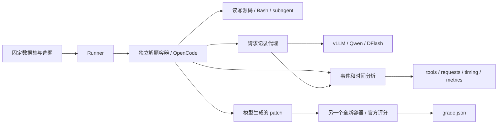

# SWE-bench Pro / OpenCode 效率评测

当前工作区用于 SWE-bench Pro + Qwen3.8-27B / DFlash / OpenCode 的求解、官方评分与效率分析。使用方法、脚本职责和统计口径统一在本 README 维护。

| 想做什么 | 入口 |
|---|---|
| 安装环境并完整评测 | [`run_pro.sh`](run_pro.sh) |
| 分步骤准备、启动、运行、查看进度 | [`scripts/pro/pro_test.py`](scripts/pro/pro_test.py) |
| 离线统计通过率、平均 TPS 和时间占比 | [`scripts/metrics/key_metrics.py`](scripts/metrics/key_metrics.py) |

目录：[快速开始](#quickstart) · [参数与提示词](#options) · [环境与下载](#environment) · [目录与脚本](#scripts) · [单题执行流程](#workflow) · [手动操作](#manual) · [结果文件](#results) · [指标统计](#metrics) · [停止与恢复](#operations) · [验证与历史数据](#validation)

以下命令均从 `/home/longyy/opencode/swe-bench-env` 执行。原来根目录的 Python 脚本已移到 `scripts/` 下，`./run_pro.sh` 用法不变。

<a id="quickstart"></a>

## 快速开始

一条命令完成：检查/安装依赖 → 准备题目镜像 → 启动 Qwen/DFlash → 等待服务就绪 → OpenCode 解题 → 官方评分 → 汇总指标 → 关闭本次模型服务。

```bash
cd /home/longyy/opencode/swe-bench-env
./run_pro.sh --output manual-runs/my-pro-01 --cohort fixed10 --indices 4
```

这是固定十题中的 Ansible 题，默认 GPU 0–3 / 端口 8000。GPU 被其他任务占用时会报错，不会停止其他实验。已经创建的目录使用 `--resume` 继续。

十题、两个 server，每个 server 同时只执行一道题，题内允许 subagent 并发：

```bash
./run_pro.sh --output manual-runs/my-pro-10 \
  --cohort fixed10 --ports 8000,8001 --gpus '0,1,2,3;4,5,6,7'
```

只安装/准备、不启动推理，以及之后继续：

```bash
./run_pro.sh --output manual-runs/my-pro-01 \
  --cohort fixed10 --indices 4 --prepare-only
./run_pro.sh --output manual-runs/my-pro-01 --resume
```

额外的执行路径提示使用 `--context-file /path/to/plan.md`；通用 prompt 使用 `--prompt-file /path/to/general.txt`。这些参数在首次创建目录时提供；`--resume` 使用已保存的输入，不能顺便更换配置。不要在 context 中提供答案或评分信息。

运行时每 30 秒打印进度。也可以单独查看：

```bash
python3 scripts/pro/pro_test.py status --output manual-runs/my-pro-01
```

结束后优先阅读 `<output>/metrics-output/key-metrics.md`；完整 token、工具和并发统计在同目录的 `metrics.md`。入口退出码为 0 只代表流程完成，通过率以官方评分为准。停止与恢复方式见[下文](#operations)。

<a id="options"></a>

## 参数与提示词

下面的选题、GPU 和提示词参数同时适用于 `run_pro.sh` 和 `pro_test.py init`，在创建新运行目录时设置。

| 参数 | 含义与默认值 |
|---|---|
| `--output` | 必填，运行目录；首次运行必须使用新目录 |
| `--cohort fixed10/public` | 默认固定十题；`public` 为冻结版本的全部 731 题 |
| `--indices 1,3,4` | 在所选 cohort 中按从 1 开始的序号选题；省略则全选 |
| `--ids-file FILE` | 每行一个完整 instance ID，优先于 cohort；通常与 indices 分开使用 |
| `--ports 8000,8001` | 模型服务端口列表，默认 `8000` |
| `--gpus '0,1,2,3;4,5,6,7'` | 每个端口对应一组 TP4 GPU，以分号分隔；默认 `0,1,2,3` |
| `--task-timeout 3600` | 单题 runtime allowance，单位秒，包含容器启动后的环境准备 |
| `--prompt-file FILE` | 替换额外的通用协作鼓励提示，保留官方题面和基本约束 |
| `--no-delegation-prompt` | 去掉额外的 subagent 鼓励提示，仍保留 subagent 工具权限 |
| `--context-file FILE` | 只选一道题时，追加该 Markdown 执行路径提示 |
| `--context-dir DIR` | 多题提示目录，每题一个 `<完整 instance_id>.md`，与 context-file 互斥 |
| `--environment-file FILE` | 分步入口使用的环境清单，默认 `.pro-env/environment.json`；一键入口会准备并注入清单 |

一键入口另支持：

| 参数 | 含义与默认值 |
|---|---|
| `--env-dir DIR` | 安装与共享依赖目录，默认工作区 `.pro-env/` |
| `--proxy URL` | 源码、Python 包、模型下载代理，默认 `http://ubuntu-lab.zinyy.tech:20172` |
| `--image-proxy URL` | 国内镜像层下载代理，默认 `http://pc.zinyy.tech:7899` |
| `--prepare-only` | 准备依赖、运行目录和镜像后退出，不启动推理 |
| `--install-only` | 仅准备依赖，不创建运行目录；仍需提供 output 参数 |
| `--resume` | 使用已有目录保存的输入继续，不同时修改选题、GPU 或提示词等配置 |
| `--health-timeout 1800` | 等待模型服务健康的超时秒数 |

**with / without subagent 在这些实验中指是否加入鼓励提示，不是开关 subagent 权限。**默认加入通用鼓励语；`--no-delegation-prompt` 对应 without。模型是否实际调用 subagent 要看轨迹。执行路径提示是另一项独立变量，用 context 参数控制。

```bash
# 有通用鼓励语，无执行路径提示（默认）
./run_pro.sh --output manual-runs/with-encouragement --cohort fixed10 --indices 4

# 无通用鼓励语，工具权限相同
./run_pro.sh --output manual-runs/without-encouragement \
  --cohort fixed10 --indices 4 --no-delegation-prompt

# 有通用鼓励语，同时追加本题执行路径提示
./run_pro.sh --output manual-runs/with-context \
  --cohort fixed10 --indices 4 --context-file /path/to/plan.md

# 完整公开集，两台 server；所有选中镜像准备好后开始求解
./run_pro.sh --output manual-runs/public-01 \
  --cohort public --ports 8000,8001 --gpus '0,1,2,3;4,5,6,7'
```

上述命令是不同实验的示例，应分别运行，避免共用 GPU/端口。初始化时会复制提示词并保存输入指纹，修改外部文件不会追溯修改旧运行。context 不应包含答案、参考 patch 或评分信息。两个独立批次可以比较，但入口没有通用 A/B 同步配对调度。

### fixed10 的逐题执行策略

重新整理的十份策略保存在 `bootstrap/contexts/fixed10/`，每份以完整 `<instance_id>.md` 命名。序号、仓库、题目和文档的对应关系见 [fixed10 策略索引](bootstrap/fixed10-contexts.md)；序号来自冻结的 `bootstrap/templates/fixed10.json`，不是公开集的序号。同一个仓库的不同题使用不同文件。

这些是 Codex subagent 根据公开题面重新编写的定位与验证路径，不是已删除旧轨迹的恢复版，也没有经过新一轮求解测速。策略不提供最终补丁或隐藏评分信息。

```bash
# 十题各自加载对应策略；每台 server 同时只处理一道题
./run_pro.sh --output manual-runs/fixed10-context-01 \
  --cohort fixed10 --context-dir bootstrap/contexts/fixed10 \
  --ports 8000,8001 --gpus '0,1,2,3;4,5,6,7'

# 也可以仅选其中一题，仍按完整 ID 读取对应文件
./run_pro.sh --output manual-runs/ansible-context-01 \
  --cohort fixed10 --indices 4 --context-dir bootstrap/contexts/fixed10
```

context-dir 只需覆盖本次选中的题；缺少任何一题对应文件时初始化会报错。初始化后，本次使用的副本位于 `<output>/contexts/`。这些策略是可复用的实验输入，清理运行记录时应保留 `bootstrap/contexts/`。

按 ID 选题时，文本文件每行填写完整 ID，例如：

```text
instance_ansible__ansible-3b823d908e8a5d17674f8c26d337d3114b7493b1-v0f01c69f1e2528b935359cfe578530722bca2c59
```

```bash
./run_pro.sh --output manual-runs/custom-01 --ids-file my_ids.txt
./run_pro.sh --help
python3 scripts/pro/pro_test.py init --help
```

公开集来自本地冻结 revision，不会自动更新到最新数据集。

<a id="environment"></a>

## 环境与下载

安装范围：

| 依赖 | 处理方式 |
|---|---|
| 评测 Python、vLLM/PyTorch/Transformers | 优先复用匹配版本的环境；缺失时在 `.pro-env/` 创建 venv 并按冻结 requirements 安装 |
| OpenCode、Pro 官方评分代码 | 复用指定 commit 的 checkout；缺失则下载到 `.pro-env/` |
| Bun、musl Bun、rg、插件依赖 | 复用缓存或下载，Bun/rg 校验本次冻结的二进制 SHA256 |
| Qwen、DFlash 权重 | 复用固定 revision 的缓存，缺失则下载；服务使用该固定 snapshot |
| skopeo | 复用可用程序；缺失时通过已有 conda 安装到独立目录 |
| 题目 Docker 镜像 | 优先本地缓存，缺失走国内镜像站并核对官方内容 |
| 解题隔离网络 | 不存在时创建；已有网络必须符合原配置 |

**宿主机需预先具备 Linux x86_64、NVIDIA 驱动、Docker Engine 及访问权限、Git、Python 3.12/venv 支持。**若 skopeo 未安装，需要已有 conda。脚本不安装 GPU 驱动、不修改系统 Docker daemon，也不自动升级正在被其他实验使用的 Python 环境。首次安装需要网络及足够磁盘；目前选中的镜像全部准备好后才开始解题，公开集批量运行尤其需要留足镜像空间。

默认源代码、Python 包和模型下载代理为 `http://ubuntu-lab.zinyy.tech:20172`；国内 Docker 镜像层使用 `http://pc.zinyy.tech:7899`。可通过 `--proxy`、`--image-proxy` 修改；镜像层不自动回退到海外源。下载日志和缓存会保留。

Docker 组已授予但当前 shell 未刷新时，`run_pro.sh` 会自动使用 `sg docker`。手动操作可先运行 `sg docker`。镜像下载的核验细节和隔离网络见[手动操作](#manual)。

<a id="scripts"></a>

## 目录与脚本职责

```text
swe-bench-env/
├── run_pro.sh                    日常一键入口
├── scripts/
│   ├── pro/                      当前 Pro 运行与环境准备
│   ├── metrics/                  离线效率指标
│   └── legacy_verified/          旧版普通 SWE-bench 脚本及配置
├── tests/                        入口和指标的自动测试
├── bootstrap/                    冻结模板、题库、版本及可复用的逐题策略
├── .pro-env/                     本机环境与共享依赖
├── manual-runs/                  标准化流程按需生成的运行目录
├── result_cmp_with_codex/
│   └── metrics-output/           保留的历史汇总
├── SWE-bench/                    普通 SWE-bench 官方代码
└── SWE-bench_Pro-os/              Pro 官方代码
```

OpenCode harness 源码位于工作区外层的 `../packages/opencode/src/`。本机原有模型缓存位于 `/home/longyy/.cache/huggingface/hub/`，Python 环境位于 `/home/longyy/anaconda3/envs/`；一键入口安装的新依赖默认由 `.pro-env/` 管理。Docker 镜像由 Docker 独立保存。

### 当前 Pro 入口

| 文件 | 具体职责 | 何时直接使用 |
|---|---|---|
| `pro_bootstrap.py` | 检查冻结版本，安装或复用依赖与权重，准备镜像；管理模型服务与评测进程的生命周期，处理恢复和退出 | 通常由 `run_pro.sh` 自动调用；排查安装或一键流程时阅读 |
| `pro_test.py` | 创建运行目录，复制冻结模板并写入本次配置；检查环境、启动 vLLM、调度任务、汇总结果 | 想分开执行某一步时使用 |

`pro_test.py` 的子命令：

| 子命令 | 做什么 | 是否启动模型 |
|---|---|---|
| `init` | 从 `bootstrap/templates/` 生成新的运行目录，默认读取 `.pro-env/environment.json` | 否 |
| `doctor` | 检查 Docker、隔离网络、依赖路径、所选镜像缓存 | 否，也不下载 |
| `pull` | 下载缺失镜像并校验，已有缓存直接复用 | 否 |
| `serve` | 前台启动本次目录的模型服务，校验 GPU/端口占用 | 是 |
| `run` | 使用本次目录的服务解题、评分、分析和汇总 | 不另起服务，但会请求已启动的模型 |
| `status` | 读取记录，显示任务状态、耗时和评分 | 否 |
| `metrics` | 从已导出的结构化记录重算完整统计与精简统计 | 否 |

### 冻结模板与调用关系

这里不是历史运行结果。`versions.json` 记录版本与模板哈希；`requirements-*.txt` 冻结 Python 依赖；`templates/` 提供每次新运行的代码、题库和默认配置。

这些模板通常由入口复制、适配到 `manual-runs/<name>/` 后执行，不需要逐个手动运行。各文件职责如下。其中主要的调用顺序是：

```text
run_pro.sh
  → pro_bootstrap.py：环境、镜像、启动和关闭服务
    → pro_test.py：初始化、模型服务、任务调度
      → 本次运行目录/runner.py：容器准备 → OpenCode → patch → 官方评分
        → trace_proxy.py + trace-plugin.ts：记录模型、工具和 session 事件
        → analyze.py：原始日志 → 每题结构化 JSON / 时间线
      → efficiency_metrics.py + key_metrics.py：跨题汇总
```

| 文件 | 用途 |
|---|---|
| `versions.json` | OpenCode、官方评分代码、模型与 draft 的 revision，二进制和冻结文件 SHA256 |
| `requirements-eval.txt` | 评测 Python 依赖 |
| `requirements-vllm.txt` | 推理服务 Python 依赖 |

#### templates 中的脚本

| 阶段 | 文件 | 输入 → 输出 / 作用 |
|---|---|---|
| 镜像准备 | `pull_images.py` | 选中题目、registry 和代理配置 → 本地 Docker 镜像与下载/内容核验记录 |
| 单题补拉 | `pull_one.py` | instance ID → 调用镜像下载器准备对应镜像 |
| 容器准备 | `sanitize-git.sh` | base commit → 清理可能暴露后续答案的 Git 元数据，包含子模块 |
| 求解与评分 | `runner.py` | 题目、配置、镜像、提示词 → patch、评分及各阶段日志 |
| 模型观测 | `trace_proxy.py` | OpenCode 的模型 HTTP 请求/流式响应 → 模型轨迹、usage、服务端指标和时间戳 |
| 工具观测 | `trace-plugin.ts` | OpenCode 的工具/session 事件 → `observation/events.jsonl` |
| 单题分析 | `analyze.py` | 原始事件、模型轨迹、生命周期记录 → `requests.json`、`tools.json`、`timing.json` 和时间线 |
| 跨题分析 | `efficiency_metrics.py` | 每题结构化 JSON → 完整效率报告，包括 tokens、TPS、工具和并发 |

精简统计脚本的源文件在 `scripts/metrics/key_metrics.py`，初始化时另行复制到运行目录。

#### templates 中的数据与配置

| 文件 | 用途 |
|---|---|
| `public.json.gz` | 固定 revision 的 731 道公开 Pro 任务，供父级评测器使用；不直接挂载给解题 agent |
| `fixed10.json` | 固定十题的 instance ID 和顺序 |
| `delegation-prompt.txt` | 默认通用 subagent 鼓励提示，命令行可覆盖或去掉 |
| `server-argv.json` | 冻结的 Qwen/DFlash vLLM 启动参数模板 |
| `registries.conf` | 镜像下载器使用的 registry 配置 |
| `plugin-package.json`、`plugin-package-lock.json` | 观测插件的离线依赖定义 |

`pro_bootstrap.py` 会核对 `versions.json` 中记录的文件哈希。需要改变某次实验的提示词时，优先使用 `--prompt-file` 或 context 参数，避免直接改冻结模板。

### 旧版普通 SWE-bench 脚本

这是普通 SWE-bench Verified 的旧脚本，不参与当前 Pro 流程。

| 文件 | 历史用途 |
|---|---|
| `evaluate_verified.py` | v5 时代的普通 Verified 解题与官方评分编排，附模型/工具时间统计 |
| `model_trace_proxy.py` | 为上述旧 evaluator 记录模型请求和流式输出；当前 Pro 使用另一份 `trace_proxy.py` |
| `pull_official_verified.py` | 拉取普通 Verified 官方镜像，跳过本地缓存并重试失败项 |
| `pull_verified.py` | 更早的 Epoch Research 镜像下载路径 |
| `rollout_timing_v2.sh` | 当时等待旧任务进入评分、暂停旧 evaluator 并切换计时实现的一次性脚本 |
| `config/opencode.jsonc` | 旧 evaluator 的模型连接配置 |
| `config/registries.conf` | 旧镜像下载器的 registry 配置 |
| `config/instance_ids.txt` | 普通 Verified 的任务 ID 列表 |

该目录只做归档分类，仍含旧机器路径和批次假设，不能当作当前可直接运行的 Pro 入口。本次没有重新执行或验证这些旧实验。

新运行目录中的脚本副本用于固定本次执行版本，因此会与 `bootstrap/templates/` 重复。修改本机入口不会自动改写已经创建的运行目录。

<a id="workflow"></a>

## 一道题的执行流程



执行顺序：

1. 根据 `instance_id` 找到公开题面、base commit、对应镜像标签。
2. 检查或下载 `jefzda/sweap-images:<dockerhub_tag>`。
3. 创建 8 CPU / 32 GiB 解题容器，限制网络，清理未来 Git 元数据，保留 base 及祖先。
4. 以官方格式生成题面，加上通用 prompt 和可选 Markdown context，启动 OpenCode。
5. OpenCode 经请求代理访问专属 vLLM server；插件记录工具和 session 事件。每个 server 同时只运行一道任务，题内 helper 可以并发。
6. OpenCode 退出后提取它自行生成的 patch，结束 agent 计时。
7. 在全新容器中，使用官方 workspace 组装、测试脚本、parser、必需通过集合评分。
8. 从原始事件生成结构化计时，再汇总 TPS、token、工具与模型的时间占比。

数据集中的参考 patch、评分测试和评分结果只供父级 evaluator 使用，不注入模型，也不挂载进解题容器。你的额外 context 文件需要自行确保不含答案。

<a id="manual"></a>

## 手动分步骤运行

下面选择固定十题中的第 4 题 Ansible。选择它是为了让你快速走通操作流程，不改变它的官方评分。

### 进入具备 Docker 权限的终端

```bash
sg docker
cd /home/longyy/opencode/swe-bench-env
PY=/home/longyy/anaconda3/envs/swebench-eval/bin/python
PRO_RUN=/home/longyy/opencode/swe-bench-env/manual-runs/ansible-baseline-01
```

`sg docker` 打开具有 Docker 组权限的 shell；若当前 shell 已能运行 `docker info`，可以省略。下面的变量要在每个新终端重新定义。

### 创建全新的测试目录

```bash
"$PY" scripts/pro/pro_test.py init \
  --output "$PRO_RUN" \
  --cohort fixed10 --indices 4 \
  --ports 8000 --gpus 0,1,2,3
```

这一步只选题、复制运行脚本和配置、建立只读依赖的链接。不会下载镜像、启动模型或开始测试。输出目录必须不存在；重复实验换一个新名字。

默认保留上次通用的 subagent 鼓励 prompt，`task` 工具可用。每次运行复制自己的 runner、proxy 和 plugin，因此新运行的配置不改动旧轨迹。

### 检查环境、准备镜像

```bash
"$PY" scripts/pro/pro_test.py doctor --output "$PRO_RUN"
"$PY" scripts/pro/pro_test.py pull --output "$PRO_RUN"
```

`doctor` 检查 Docker、官方代码、OpenCode、共享依赖、隔离网络和镜像缓存；它不是模型健康检查。`pull` 优先复用本地镜像；缓存命中不下载。

当前下载脚本的配置是：

- 官方 manifest/config 小文件：通过 `http://ubuntu-lab.zinyy.tech:20172` 获取并固定 digest。
- 镜像层：尝试 `docker.1ms.run`，使用 `http://pc.zinyy.tech:7899`。
- 新导入镜像比对官方 runtime config、解压层 diff IDs、OS 和架构；镜像站失败时不自动改走海外大流量路径。

镜像站可能缺层或传输停滞，失败日志在 `images/<id>/`。新流程优先检查本机 Docker 缓存，仅对缺失镜像下载。

隔离网络在这台机器已存在。如在重建环境时确认它不存在，原 harness 使用的是：

```bash
docker network create --internal --subnet 172.18.0.0/16 swe-isolated
```

不要重建已有的网络；runner 依赖其 gateway 为 `172.18.0.1`。

### 终端 A：启动模型服务

```bash
"$PY" scripts/pro/pro_test.py serve --output "$PRO_RUN"
```

该命令前台运行，建议放在 `tmux` 中。另一个终端检查：

```bash
tail -n 30 "$PRO_RUN/server-8000.log"
curl --fail --noproxy '*' http://127.0.0.1:8000/health
```

只有 health 成功后再执行下一步。当前 Qwen 模板为 TP4、BF16、262144 target context、DFlash2、7 个 speculative tokens、2048 draft window、`max_num_seqs=8`，保留逐请求时间和投机解码指标。

**当前已有实验占用 GPU 时，serve 会拒绝启动。**它不会停止其他任务。等待已有实验释放 GPU，或明确选择四张空闲 GPU；单独换端口并不能释放显存。

### 终端 B：执行、评分、汇总

```bash
sg docker
cd /home/longyy/opencode/swe-bench-env
PY=/home/longyy/anaconda3/envs/swebench-eval/bin/python
PRO_RUN=/home/longyy/opencode/swe-bench-env/manual-runs/ansible-baseline-01
"$PY" scripts/pro/pro_test.py run --output "$PRO_RUN"
```

`run` 要求该目录自己启动的服务存在且健康，避免误借其他实验的 server。它会切换到官方 evaluator 工作目录，处理其 `dockerfiles/` 相对路径依赖。

一条命令包括：解题 → 导出 patch → 独立官方评分 → 单题时间分析 → 全部已结束任务的效率汇总。所有选定镜像必须先准备好；新入口不自动启动公开集后台下载器，也不删除共享 Docker 镜像。

查看进度：

```bash
"$PY" scripts/pro/pro_test.py status --output "$PRO_RUN"
```

运行完成后看：

```bash
cat "$PRO_RUN/metrics-output/key-metrics.md"
```

服务会留在终端 A，便于检查日志。确定不再使用后，在终端 A 按 Ctrl-C，入口只关闭它自己启动的进程组。

<a id="results"></a>

## 结果文件与完整报告

```text
manual-runs/<name>/
├── config.json、selected.json、input-hashes.json  配置、任务和输入指纹
├── delegation-prompt.txt、contexts/              附加提示
├── server-<port>.log                             vLLM 启动和推理日志
├── images/<id>/status.json                       镜像准备结果
├── runs/<id>/
│   ├── official-task.txt、prompt.txt             官方题面和真正发送的完整 prompt
│   ├── lifecycle.jsonl                          外层阶段起止
│   ├── observation/events.jsonl                 OpenCode 工具和 session 原始事件
│   ├── model-requests.jsonl                     完整请求和流式响应记录，可能很大
│   ├── opencode.log                            OpenCode CLI 输出
│   ├── result.json                             agent 耗时、退出状态、预算、patch 信息、grade
│   ├── model.patch、prediction.json             本次模型生成的补丁
│   ├── grade.json                              官方评分是否 resolved
│   ├── grading-workspace/                       独立评分脚本、stdout、stderr、output.json
│   ├── requests.json、tools.json、timing.json    分析后的结构化数据
│   └── timeline.html                           可缩放、悬停的请求/工具时间线
└── metrics-output/
    ├── key-metrics.md、key-metrics.json         精简指标，只展示逐题平均
    └── metrics.md、metrics.json                 完整跨题效率汇总
```

先看 `result.json`/`grade.json` 判断是否成功，再看效率。进程退出码 0 不代表解题通过；达到输出上限、空 patch、隐藏测试失败都需要保留。官方判定使用必需测试集合，不能只根据 parser 输出中出现的测试全是 PASSED 就认为 resolved。

运行结束自动生成完整和精简报告；也可以离线重算。只需每题的 `result.json`、`timing.json`、`requests.json`、`tools.json`，不需要模型或 Docker。精简统计及其分母见[下一节](#metrics)。

完整报告还包含 prompt/response token、工具分布和并发，单独生成方式如下：

```bash
python3 bootstrap/templates/efficiency_metrics.py \
  /path/to/campaign --output-dir /path/to/metrics-output
```

完整报告与精简报告的区别：

- 完整报告部分占比按累计任务秒数、TPS 按跨题请求加权；精简报告先逐题计算，再等权平均。跨题累计秒数不是两台 server 的批次日历时间。
- 完整报告的 `source_view` 包含主子模型和普通工具，`parent_view` 把父级 task 包装调用视为工具，不含后台 task 返回后的完整子生命周期。精简报告把完整观测到的 subagent 生命周期归入工具，内部模型与工具不重复计数。
- 普通模型、工具各自活跃占比可能重叠；只有互斥时间分区才相加为 100%。
- 累计 prompt token 是每次请求输入量之和，包含重复上下文；不等于唯一上下文长度，也不等于实际重新 prefill 的 token 数。

<a id="metrics"></a>

## 精简指标：TPS、时间占比和并行上界

**agent wall time 从 OpenCode 启动到退出，排除镜像、环境准备、patch 导出和官方评分。**工具起止来自 OpenCode 事件；模型计时来自代理记录的 vLLM 返回字段，具体估算方式见本节末尾。

入口是 `scripts/metrics/key_metrics.py`（以下命令从工作区根目录执行），只依赖 Python 3.9+ 标准库。离线读取每题的 `result.json`、`timing.json`、`requests.json`、`tools.json`，无需原始大日志、模型、Docker 或网络。

### 运行

正常 `pro_test.py run` 或 `run_pro.sh` 结束后自动生成。已有数据可执行：

```bash
python3 scripts/pro/pro_test.py metrics --output /path/to/run
```

完整统计仍保存在 `metrics.md/json`；终端只打印精简表。旧目录没有复制的新脚本时，入口使用 `scripts/metrics/` 中的版本。

也可独立执行、迁移使用：

```bash
python3 scripts/metrics/key_metrics.py /path/to/run --output-dir /path/to/run/metrics-output

# 十题 A/B：自动发现 arms/baseline 与 arms/path，展示两列平均值
python3 scripts/metrics/key_metrics.py /path/to/paired-run \
  --output-dir /path/to/paired-run/metrics-output

# 任意两个或多个批次可作为并列输入；题目集合是否一致由使用者确认
python3 scripts/metrics/key_metrics.py /path/to/run-a /path/to/run-b --output-dir /path/to/comparison
```

输入也支持 `runs/` 或单题目录。输出 `key-metrics.md`（阅读用）和 `key-metrics.json`（同样只包含均值、样本数与覆盖信息）。不传 `--output-dir` 时只打印，不写文件；不提供输入目录时读取当前工作目录。

### 平均值定义

- 通过率：`官方评分通过题数 / 本表纳入的求解题数`。无有效评分或评分环境失败时不猜测结果，整列通过率标为 N/A，并显示有效评分覆盖数；未进入求解的题不在这份效率报告的分母中。
- 时间：`mean(每题该类别的秒数)`。
- 占比：`mean(每题该类别秒数 / 每题 agent wall time × 100%)`，所有题等权；不是累计秒数的比例。因此“平均阶段秒 / 平均求解秒”可能不等于表中的平均占比。
- Decode TPS：每题先计算 `Σ(completion_tokens - 1) / Σ(generation_time_ms / 1000)`，只使用有有效 token 和生成计时、完整落在任务内的已完成主级请求，再对各题 TPS 取算术平均。没有有效 TPS 的题记为缺失，不补零；覆盖数另列。
- 主级请求包含主会话、title、compaction、summary，排除子会话的所有请求。与旧 `efficiency_metrics.py` 全角色、跨题请求加权 TPS 不同。
- 所有已结束、进入模型求解且具备分析文件的题默认纳入，包括答错或触及预算的题。`--exclude-censored` 可排除任务时间/调用预算终止；它不会排除所有达到单请求输出上限的题。
- 未完成、启动前失败、尚未导出分析数据的题排除，报告显示覆盖信息。缺少请求计时的已纳入题仍保留相应墙钟时间，归入其余。

### 工具并行优化的理想上界

精简报告额外展示当前工具活跃时间、理想工具时间下界、最多可减少时间、最多可减少比例。前三项只展示每题平均秒数。这个估计使用同一批纳入题目，**subagent 也算工具**。

每题计算：

```text
U = 所有主级工具活跃区间的并集长度
L = 该题最长单项工具的观测时长
最多可减少工具时间 = U − L
表内最多可减少比例 = mean(U − L) / mean(U) × 100%
```

**该比例的分母是当前工具并集的平均时间，不是完整求解时间，也不是各题减少百分比的平均。**没有工具时间时，时间列为零、比例为 N/A。JSON 中每组的 `tool_parallel_bound` 保存三个均值以及 `maximum_reduction_percent_of_mean_tool_union`。

主级普通工具各为一项；同一 subagent 的包装调用与完整观测生命周期先取并集，合为一项，嵌套子会话继续折叠到顶层 subagent。其内部模型、工具不会再成为额外主级调用。没有观测到的包装/生命周期间隙不补时；无法关联到子会话的包装调用独立保留。所有区间裁剪到求解起止，超时或中止的调用只代表已观测部分。

这里保留模型与工具重叠的时间，因此 **U 是工具活跃时间，不等于上方互斥分区中的“工具执行”**。各项 subagent 内部也按不透明的整体处理，这个估计不尝试重新调度其内部动作。

假设固定现有调用及每项观测耗时，忽略读/改/测依赖和资源限制，将其他工作完全藏在最长调用内。L 是宽松的时间下界，U−L 是这种固定工作量下仅调整重叠安排的收益上界；真实依赖通常让可达收益更小。它不是实测提速、不是完整求解时间降幅，也不是允许改写命令、复用缓存、减少验证工作量时的全局最优界。

最长调用受工具接口粒度影响：一个 Bash 调用可以包含读、改、测试等多个动作。拆分这种调用会改变 L，因此不同 harness 的上界差异不能单独作为绝对并行效率或最优程度的排名依据。

### 时间分类与并发

四个主类别为 Decode、Prefill、工具执行、其余。Decode 细分为 reasoning、非 reasoning；工具细分为普通工具、subagent。父行已包含子行，不要把父子行重复相加。

- 非 reasoning 包含最终可见文字和工具参数生成。
- 普通工具只包含主级调用；子会话内部模型、工具以及间隙全部折叠为 subagent 的观测生命周期。`task` 包装区间也保留并合并，后台任务不会因包装提前返回而漏掉后续活动。
- 所有区间裁剪至 agent 起止。同一细分类并发取并集；不同细分类同时活跃的交集统一归入“其余”。这样不需要人为规定“模型优先”或“工具优先”，六个叶子类别相加等于任务墙钟时间。
- 其余包含跨细分类重叠、排队/传输、编排等待、缺少足够数据的区间。因此它不是纯空闲时间。
- 此表是互斥分区，不代表某工具所有活跃时间的并集。后台 subagent 和主模型重叠的部分在其余中，不在 subagent 独占行中。
- 未四舍五入的四个主类别平均占比合计 100%；显示值可能有 0.01 个百分点的尾差。

### Prefill 和 Decode 的计时来源

当前冻结 vLLM 的 `build_per_request_timing_metrics()` 位于 `vllm/entrypoints/generate/base/serving.py`：

- `generation_time_ms = last_token_ts - first_token_ts`，即 decode 时长。
- **`time_to_first_token_ms = first_token_ts - scheduled_ts`**。此字段在本仓库当前 vLLM 中与服务端 prefill histogram 的时长定义一致，不含 queued→scheduled 的队列时间。
- 不能将客户端 `ttft_wall_seconds` 当作 prefill；它还包括队列、传输等。

现有日志保存了服务端阶段时长，未保存其绝对墙钟端点。因此脚本把 last-token 对齐到 proxy 的 request_end，再向前放置 decode、prefill；剩余请求开销归入其余。reasoning 分界按流式最后 reasoning 与首次非 reasoning 的交付边界中点，映射到 decode 区间。边界缺失或交错时退化为流式阶段时长比例，混合片段均分；覆盖信息会标明退化请求数。没有可用分界的 decode 时间归入其余，不虚构分类。

**阶段位置、reasoning 拆分以及由此计算的重叠均为估算，不是 GPU kernel profile。**服务端提供的是请求阶段延迟，可能包含调度间隙。

若换用其他日志导出器，先确认字段语义；显式 `prefill_time_ms` 优先。若其他导出器的 TTFT 包含排队，可用 `--prefill-field prefill_time_ms` 禁止把 TTFT 当作 prefill；缺失的 prefill 归入其余。不要直接套用当前自定义 TTFT 语义。

<a id="operations"></a>

## 停止、恢复与常见问题

一键入口 `run_pro.sh`：运行期间 Ctrl-C 停止派发新题，等待当前题求解与评分结束，再释放本次服务；准备阶段中断会保留下载缓存。已创建的运行目录使用 `--resume` 继续。已有 `result.json` 的失败题也视为已完成尝试，不自动重试。

下面的进程操作针对手动分开的 `serve` / `run` 流程。

| 情况 | 处理方式 |
|---|---|
| GPU 或端口被占用 | 查看拥有者和现有实验进度；入口会拒绝抢占。等待释放或选空闲资源。 |
| `/health` 尚未成功 | 看 server 日志；模型加载与编译需要时间。不要同时再启动一份相同服务。 |
| 镜像缺失 | 先执行 `pull`；失败看该题 images 日志，镜像站路由无自动海外大层回退。 |
| 共享 assets/infra-fix 链接缺失 | 恢复其实际目标目录；仅复制实验目录不足以迁移整个执行环境。 |
| 普通测试能跑但官方评分失败 | 看 grading-workspace 中完整测试输出与必需集合；不是所有失败都属于环境问题。 |
| 需要结束手动 run 启动的批次 | 从另一个终端向 runner PID 发送 SIGTERM，停止派发新题，当前题继续到结束/原预算；run 退出后再在 serve 终端 Ctrl-C 释放 GPU。 |
| 继续未派发的题 | 在相同目录重新启动/确认 serve，再执行 run；已有 result.json 的题会跳过，包括失败题。 |
| 要重新跑某道失败题 | 新建一个运行目录并选择该题，保留旧结果。不会依据评分自动重新解题。 |

停止派发的命令如下，PID 来自本次目录的 `runner-process.json`。执行前应确认它仍是本次 runner；已结束的批次不需要执行。

```bash
RUNNER_PID=$("$PY" -c 'import json,sys; print(json.load(open(sys.argv[1]))["pid"])' "$PRO_RUN/runner-process.json")
ps -p "$RUNNER_PID" -o pid,args
kill -TERM "$RUNNER_PID"
```

手动运行时，不要用 run 终端的 Ctrl-C 代替平滑停止：终端的 SIGINT 还可能传给当前 Docker/评分子进程，导致本题提前结束。若强制终止后留下了没有 `result.json` 的半成品目录，应另建运行目录重跑，避免混用残留轨迹。

单题默认 runtime allowance 为 3600 秒，从解题容器成功启动后计算，**环境准备会消耗这项运行预算**；统计出的 agent wall time 仍只包含 agent 阶段。`--task-timeout` 可以在初始化时改变它；改变后就与原实验预算不同。Bash 默认统一上限 450 秒；整题模型调用预算为 250（排除 title，包含子 agent 和 compaction）；proxy 把温度设为 0、top_p 为 1、seed 为 20260913，输出上限至多 32768，OpenCode 实际请求可能更小，例如 32000。

不带 `--environment-file` 的分步入口默认读取工作区的 `.pro-env/environment.json`；一键入口会生成环境清单并把实际安装路径写入新 runner，因此可以使用独立 `--env-dir`。换模型仍需要同步修改服务参数和 runner 的 OpenCode provider/model 配置。只改文件夹名字不会完成模型迁移。

<a id="validation"></a>

## 验证与历史数据

| 文件 | 验证内容 |
|---|---|
| `test_pro_test.py` | 新运行初始化、context 路由、输入指纹、GPU/服务保护、状态计时、统计入口 |
| `test_pro_bootstrap.py` | 安装复用、环境路径注入、服务启动失败、进程退出清理和中断排空 |
| `test_key_metrics.py` | 通过率与均值口径、阶段划分、并发去重、子 agent 生命周期、工具并行上界 |

```bash
python3 -m unittest discover -s tests -v
```

这些测试会使用临时文件、本地测试 wheel 和测试 HTTP 进程，不启动真实模型，不执行 SWE 解题或下载镜像。

最近一次脚本整理后，23 项测试通过；本机 Ansible 的实际 `--prepare-only`、恢复检查和临时初始化/doctor 也已通过，使用缓存镜像，未启动推理。冻结 runner 复用了此前完成过求解与评分的实现；**新机器从零下载全部依赖，以及标准化一键入口从真实 GPU 推理到评分，尚未完整复测。**

2026-09-20 已按要求清除标准化流程之前的运行记录，只保留 `result_cmp_with_codex/metrics-output/` 下四份历史静态汇总。其原始轨迹已删除，无法重新计算，不应向该目录重新生成统计。标准化入口、冻结输入、环境与 Docker 镜像保留。`manual-runs/` 中的旧准备记录也已清理，空目录已移除；后续运行会按需创建 `manual-runs/<name>/`，无需手动恢复。
