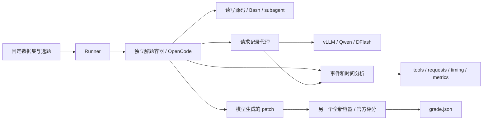

# SWE-bench Pro / OpenCode 效率评测

当前工作区用于 SWE-bench Pro + Qwen3.8-27B / DFlash / OpenCode 的求解、官方评分与效率分析。使用方法、脚本职责和统计口径统一在本 README 维护。

| 想做什么 | 入口 |
|---|---|
| 普通 Pro 评测：安装、推理、评分、汇总、关闭服务 | [`run_pro.sh`](run_pro.sh)，见[快速开始](#quickstart) |
| 8B 候选 + 27B 审核/独立生成实验 | [`services.py`](scripts/semantic_gate/services.py) 启动服务，再用 `pro_test.py` 评测，见[完整操作](#semantic-gate) |
| 分步骤准备、运行、查看进度 | [`scripts/pro/pro_test.py`](scripts/pro/pro_test.py) |
| 普通评测的离线平均指标 | [`scripts/metrics/key_metrics.py`](scripts/metrics/key_metrics.py) |
| 转接口内部各模型的物理 TPS、审核/压缩/重叠 | [`scripts/semantic_gate/metrics.py`](scripts/semantic_gate/metrics.py) |

目录：[交接先读](#handoff) · [快速开始](#quickstart) · [参数与提示词](#options) · [8B→27B 审核实验](#semantic-gate) · [实验结果索引](#experiments) · [环境与下载](#environment) · [迁移项目](#migration) · [目录与脚本](#scripts) · [单题执行流程](#workflow) · [手动操作](#manual) · [结果文件](#results) · [指标统计](#metrics) · [停止与恢复](#operations) · [验证与历史数据](#validation)

以下命令均从项目根目录执行，本机为 `/home/longyy/opencode/swe-bench-env`；换机器时替换 `cd` 路径。原来根目录的 Python 脚本已移到 `scripts/` 下，`./run_pro.sh` 用法不变。

<a id="handoff"></a>

## 交接先读

本项目研究 **OpenCode 求解 SWE-bench Pro 的效率及质量**。先用官方评分判断是否解题，再比较 agent 阶段的墙钟时间、tokens、TPS、工具和 subagent 开销。镜像准备、容器环境准备、官方评分另行记录，不计入 agent 求解时间。

接手时先区分三个流程：普通 Pro 是完整的一键评测；8B 转接口只有服务启动被合并为一条命令，评测仍按 `init → doctor → pull → run` 执行；`scripts/legacy_verified/` 是旧普通 SWE-bench Verified 归档，不是 Pro 入口。普通评测的两台 server 各处理一条任务队列；转接口的两台模型共同处理一条队列，题内仍可有并发 subagent。

截至本次文档整理（2026-09-27），最后开展的是 **8B TP4 / thinking / YaRN 128K + 27B TP4 / DFlash / overlap** 实验。只完成了相同前两题的配对与重跑，**没有完成 fixed10，更没有这套方案的完整公开集成绩，也没有证明保持质量的端到端加速**。最后一次重跑为 1/2 通过，平均 agent 时间 1797.98 秒。详情与原始报告入口见[实验结果索引](#experiments)。这些是已结束的记录；历史报告中的“服务仍在运行”等文字只描述撰写当时，当前进程状态需用 `services.py status` 确认。

建议阅读顺序：本节 → 想运行的流程 → [结果与统计口径](#results) → [停止与恢复](#operations)。迁移机器先读[迁移项目](#migration)。**`.pro-env/` 和 `manual-runs/` 不在 Git 中；只交付代码不会交付本机依赖或最新实验记录。**

**只看现有实验，直接打开 [manual-runs/key-metrics.md](manual-runs/key-metrics.md)。**它列出每组实验在测什么、通过了几题、耗时、TPS 和采用率，并链接各批次主报告。`manual-runs/` 外层只保留这一页和 `details/`；不再需要从四个旧 `semantic-*` 目录中寻找结果。

<a id="quickstart"></a>

## 快速开始

一条命令完成：检查/安装依赖 → 准备题目镜像 → 启动 Qwen/DFlash → 等待服务就绪 → OpenCode 解题 → 官方评分 → 汇总指标 → 关闭本次模型服务。

```bash
cd /home/longyy/opencode/swe-bench-env
./run_pro.sh --output manual-runs/details/evaluations/my-pro-01 --cohort fixed10 --indices 4
```

这是固定十题中的 Ansible 题，默认 GPU 0–3 / 端口 8000。GPU 被其他任务占用时会报错，不会停止其他实验。已经创建的目录使用 `--resume` 继续。

十题、两个 server，每个 server 同时只执行一道题，题内允许 subagent 并发：

```bash
./run_pro.sh --output manual-runs/details/evaluations/my-pro-10 \
  --cohort fixed10 --ports 8000,8001 --gpus '0,1,2,3;4,5,6,7'
```

另一种启动方式是先准备、不启动推理，之后继续；下面使用独立的新目录：

```bash
./run_pro.sh --output manual-runs/details/evaluations/my-pro-prepared \
  --cohort fixed10 --indices 4 --prepare-only
./run_pro.sh --output manual-runs/details/evaluations/my-pro-prepared --resume
```

额外的执行路径提示使用 `--context-file /path/to/plan.md`；通用 prompt 使用 `--prompt-file /path/to/general.txt`。这些参数在首次创建目录时提供；`--resume` 使用已保存的输入，不能顺便更换配置。不要在 context 中提供答案或评分信息。

运行时每 30 秒打印进度。也可以单独查看：

```bash
python3 scripts/pro/pro_test.py status --output manual-runs/details/evaluations/my-pro-01
```

结束后只需先打开 `<output>/key-metrics.md`。其余报告、逐题记录、配置和日志统一放在 `<output>/details/`；详细 token、工具和并发统计在 `details/metrics-output/metrics.md`。入口退出码为 0 只代表流程完成，通过率以官方评分为准。停止与恢复方式见[下文](#operations)。

<a id="options"></a>

## 参数与提示词

下面的选题、GPU 和提示词参数同时适用于 `run_pro.sh` 和 `pro_test.py init`，在创建新运行目录时设置。

| 参数 | 含义与默认值 |
|---|---|
| `--output` | 必填，运行目录；首次运行必须使用新目录 |
| `--cohort fixed10/public` | 默认固定十题；`public` 为冻结版本的全部 731 题 |
| `--indices 1,3,4` | 在所选 cohort 中按从 1 开始的序号选题；省略则全选 |
| `--ids-file FILE` | 每行一个完整 instance ID，优先于 cohort；通常与 indices 分开使用 |
| `--ports 8000,8001` | 模型服务端口列表，默认 `8000` |
| `--gpus '0,1,2,3;4,5,6,7'` | 每个端口对应一组 TP4 GPU，以分号分隔；默认 `0,1,2,3` |
| `--task-timeout 3600` | 单题 runtime allowance，单位秒，包含容器启动后的环境准备 |
| `--prompt-file FILE` | 替换额外的通用协作鼓励提示，保留官方题面和基本约束 |
| `--no-delegation-prompt` | 去掉额外的 subagent 鼓励提示，仍保留 subagent 工具权限 |
| `--context-file FILE` | 只选一道题时，追加该 Markdown 执行路径提示 |
| `--context-dir DIR` | 多题提示目录，每题一个 `<完整 instance_id>.md`，与 context-file 互斥 |
| `--environment-file FILE` | 分步入口使用的环境清单，默认 `.pro-env/environment.json`；一键入口会准备并注入清单 |
| `--gateway-run-dir DIR` | 实验参数，仅用于分步 init：连接这个目录管理的 8B→27B 审核服务；一条任务队列 |

一键入口另支持：

| 参数 | 含义与默认值 |
|---|---|
| `--env-dir DIR` | 安装与共享依赖目录，默认工作区 `.pro-env/` |
| `--proxy URL` | 源码、Python 包、模型下载代理，默认 `http://ubuntu-lab.zinyy.tech:20172` |
| `--image-proxy URL` | 国内镜像层下载代理，默认 `http://pc.zinyy.tech:7899` |
| `--prepare-only` | 准备依赖、运行目录和镜像后退出，不启动推理 |
| `--install-only` | 仅准备依赖，不创建运行目录；仍需提供 output 参数 |
| `--resume` | 使用已有目录保存的输入继续，不同时修改选题、GPU 或提示词等配置 |
| `--health-timeout 1800` | 等待模型服务健康的超时秒数 |

**with / without subagent 在这些实验中指是否加入鼓励提示，不是开关 subagent 权限。**默认加入通用鼓励语；`--no-delegation-prompt` 对应 without。模型是否实际调用 subagent 要看轨迹。执行路径提示是另一项独立变量，用 context 参数控制。

```bash
# 有通用鼓励语，无执行路径提示（默认）
./run_pro.sh --output manual-runs/details/evaluations/with-encouragement --cohort fixed10 --indices 4

# 无通用鼓励语，工具权限相同
./run_pro.sh --output manual-runs/details/evaluations/without-encouragement \
  --cohort fixed10 --indices 4 --no-delegation-prompt

# 有通用鼓励语，同时追加本题执行路径提示
./run_pro.sh --output manual-runs/details/evaluations/with-context \
  --cohort fixed10 --indices 4 --context-file /path/to/plan.md

# 完整公开集，两台 server；所有选中镜像准备好后开始求解
./run_pro.sh --output manual-runs/details/evaluations/public-01 \
  --cohort public --ports 8000,8001 --gpus '0,1,2,3;4,5,6,7'
```

上述命令是不同实验的示例，应分别运行，避免共用 GPU/端口。初始化时会复制提示词并保存输入指纹，修改外部文件不会追溯修改旧运行。context 不应包含答案、参考 patch 或评分信息。两个独立批次可以比较，但入口没有通用 A/B 同步配对调度。

### fixed10 的逐题执行策略

重新整理的十份策略保存在 `bootstrap/contexts/fixed10/`，每份以完整 `<instance_id>.md` 命名。序号、仓库、题目和文档的对应关系见 [fixed10 策略索引](bootstrap/fixed10-contexts.md)；序号来自冻结的 `bootstrap/templates/fixed10.json`，不是公开集的序号。同一个仓库的不同题使用不同文件。

这些是 Codex subagent 根据公开题面重新编写的定位与验证路径，不是已删除旧轨迹的恢复版，也没有经过新一轮求解测速。策略不提供最终补丁或隐藏评分信息。

```bash
# 十题各自加载对应策略；每台 server 同时只处理一道题
./run_pro.sh --output manual-runs/details/evaluations/fixed10-context-01 \
  --cohort fixed10 --context-dir bootstrap/contexts/fixed10 \
  --ports 8000,8001 --gpus '0,1,2,3;4,5,6,7'

# 也可以仅选其中一题，仍按完整 ID 读取对应文件
./run_pro.sh --output manual-runs/details/evaluations/ansible-context-01 \
  --cohort fixed10 --indices 4 --context-dir bootstrap/contexts/fixed10
```

context-dir 只需覆盖本次选中的题；缺少任何一题对应文件时初始化会报错。初始化后，本次使用的副本位于 `<output>/details/contexts/`。这些策略是可复用的实验输入，清理运行记录时应保留 `bootstrap/contexts/`。

按 ID 选题时，文本文件每行填写完整 ID，例如：

```text
instance_ansible__ansible-3b823d908e8a5d17674f8c26d337d3114b7493b1-v0f01c69f1e2528b935359cfe578530722bca2c59
```

```bash
./run_pro.sh --output manual-runs/details/evaluations/custom-01 --ids-file my_ids.txt
./run_pro.sh --help
python3 scripts/pro/pro_test.py init --help
```

公开集来自本地冻结 revision，不会自动更新到最新数据集。

<a id="semantic-gate"></a>

## 8B 生成、27B 审核的转接口实验

代码在 [scripts/semantic_gate/](scripts/semantic_gate/)，不会改动冻结的 runner 模板。最后一次实验配置如下；这是复现实验的配置，不是已经验证更快的推荐方案。

| 项目 | 最后一次实验使用值 |
|---|---|
| 27B | GPU 0–3，Qwen3.8-27B，TP4、BF16、DFlash，`num_speculative_tokens=7`，上下文 262144 |
| 8B | GPU 4–7，Qwen3-8B，TP4、BF16、普通解码、thinking 开启，reasoning + 工具参数合计最多 8192 token |
| 8B 上下文 | 131072；启动脚本添加 YaRN factor=4、原始长度 32768 |
| 8B 输入压缩门限 | 容量减去当前输出预算；8192 输出预算时为 122880 |
| 调度 | `--overlap-target`，27B 原请求独立生成与候选分支竞速，`first_ready_v2` |
| 8B revision | `b968826d9c46dd6066d109eabc6255188de91218` |

**新目录的脚本默认值仍是 TP2 / 131072 / thinking 关闭 / 2048 输出 / 串行。**下面的启动命令显式覆盖这些默认值。先前原生 32K、thinking 关闭和不同 TP 的实验见[结果索引](#experiments)，比较时不能把所有差异归因于单个开关。

```text
OpenCode → 原有请求记录代理 → semantic gate :8002
                              ├─ 27B 原请求独立生成 → 完整结果就绪即返回 ─────┐
                              └─ 必要时 27B 压缩 → 8B 候选                 │
                                  ↓ 工具名、JSON Schema、完整性检查       │
                              27B 完整历史审核，只生成 A/R                │
                                  ├─ A → 取消/丢弃后台 27B，返回 8B       │
                                  └─ R/异常 → 释放已暂存前缀并接续同一生成 ┘
                              OpenCode 收到选定结果后才执行工具
```

27B 审核关闭 thinking，并限制为 A/R 的结构化选择、最多 2 token（含结束标记）。审核 prompt 在 [bootstrap/semantic-gate-review.txt](bootstrap/semantic-gate-review.txt)，重点是调用是否为有依据且符合约束的下一步，不要求与 27B 自己会选择的动作完全相同。一次输出的多个工具调用整批接受或拒绝；审核过程不实际执行工具。候选不完整、工具格式错误、审核超时或异常均回退。最终文字答复、标题及其他无工具请求直接使用 27B。

`--draft-thinking` 会为 8B 启用 thinking，代码将采样设为 `temperature=0.6, top_p=0.95, top_k=20, min_p=0`；审核和压缩仍关闭 thinking。用 `--draft-tokens` 指定 reasoning 加工具调用的合计输出上限。返回候选的逻辑 usage 使用 27B tokenizer 估计，并包括返回的 reasoning，物理 token 消耗以 gateway 各阶段的 vLLM usage 为准。

原生 32K 对照使用 `--draft-context 32768`，其 8192 输出预算下的输入门限为 24576。门限由容量自动计算，无需另改固定阈值。当前启动代码对大于 40960 的容量固定添加 factor=4 的 YaRN 配置，并非任意上下文长度的通用自动适配器。

长历史先交给 27B，使用 [压缩 prompt](bootstrap/semantic-gate-compress.txt) 生成工作记忆，仅供 8B 使用。保留原始系统约束、首个用户任务，并尽量保留近期完整工具轮次；若仍放不下，扩大压缩范围。压缩后仍超过容量或压缩未完成则回退。**27B 审核和回退生成始终使用原始完整历史**。同一会话只有在历史前缀完全匹配时才复用已有摘要，避免每轮重复压缩。这个代理内部压缩与 OpenCode 自身的 compaction 分开记录。

这属于语义审核，不能保证与纯 27B 无损等价；接受率不能代替 SWE 官方通过率。能否加速取决于节省的 27B 生成时间是否大于 8B 生成、审核、压缩和失败回退的额外成本。

**竞速返回（first_ready_v2）：27B 的完整结果与审核通过的 8B 候选，谁先就绪就返回谁，取消另一条分支。27B 先完成时，候选、压缩或审核无论进行到哪一步都不再等待。** 拒绝候选则接续同一条 27B 生成。审核和独立生成共享 27B 的四张 GPU，允许 vLLM continuous batching；仍需测量审核对 27B 的算力干扰，竞速策略本身不保证相对独占 GPU 的纯 27B 绝不变慢。27B 独立生成保留调用方的 thinking 与采样设置。

### 1. 准备环境与 8B 权重

已有可用的 `.pro-env/environment.json` 时可跳过安装。新机器先满足[宿主前置条件](#environment)，再安装共享依赖及 27B/DFlash；这一步不启动推理，也不下载题目镜像：

```bash
./run_pro.sh --output manual-runs/details/evaluations/install-check --install-only
```

`services.py` 当前固定读取项目根目录的 `.pro-env/environment.json`，没有 `--environment-file` / `--env-dir` 参数；此流程请使用默认环境目录。8B 不在普通 bootstrap 的安装范围内，需单独准备。

在同一终端执行下列命令，复用已有缓存或下载冻结的 8B 权重，并保存实际路径。代理地址按接手机器情况修改；已知完整 snapshot 路径时，也可直接设置 `DRAFT_PATH=/实际路径`，跳过下载命令。

```bash
VLLM_PY=$(python3 -c 'import json; print(json.load(open(".pro-env/environment.json"))["vllm_python"])')
PY=$(python3 -c 'import json; print(json.load(open(".pro-env/environment.json"))["python"])')
DOWNLOAD_PROXY=http://ubuntu-lab.zinyy.tech:20172
DRAFT_PATH=$(env -u ALL_PROXY -u all_proxy HF_HUB_DISABLE_XET=1 \
  HTTP_PROXY="$DOWNLOAD_PROXY" HTTPS_PROXY="$DOWNLOAD_PROXY" \
  http_proxy="$DOWNLOAD_PROXY" https_proxy="$DOWNLOAD_PROXY" \
  "$VLLM_PY" -c \
  'from huggingface_hub import snapshot_download; print(snapshot_download("Qwen/Qwen3-8B", revision="b968826d9c46dd6066d109eabc6255188de91218", allow_patterns=["*.json", "*.safetensors", "*.jinja", "*.txt"], max_workers=4))')
```

### 2. 启动和检查服务

GPU 0–7 和端口 8000–8002 需可用。每次改变配置使用新服务目录，下面显式复现最后一次 YaRN/thinking/overlap 配置：

```bash
GATE_RUN="$PWD/manual-runs/details/services/gate-demo-01"
PRO_RUN="$PWD/manual-runs/details/evaluations/gate-demo-01"
python3 scripts/semantic_gate/services.py start --output "$GATE_RUN" \
  --draft-path "$DRAFT_PATH" --draft-tp 4 --draft-context 131072 \
  --draft-tokens 8192 --draft-thinking --overlap-target
python3 scripts/semantic_gate/services.py status --output "$GATE_RUN"
```

实际端口固定为：27B `8000`、8B `8001`、转接口 `8002`；模型 baseURL 为 `http://127.0.0.1:8002/v1`。脚本只管理记录了 PID 和启动标识的本次服务，GPU/端口占用时会拒绝启动。**start 返回不等于加载完成；重复执行 status，直到三项服务的 healthy 都为 true，再开始求解。**加载失败看 `server-27b.log`、`server-8b.log`、`proxy.log`，不要另起一份。

`--draft-tp` 可选 1/2/4；27B 固定 TP4。已有服务目录的 start/restart-proxy 默认读取保存配置，变更参数需新目录。原生 32K 对照应另建目录并改 `--draft-context 32768`，其余变量保持一致；两组不能同时占用这里固定的 GPU/端口。

### 3. 使用标准 Pro 流程测试

当前终端需有 Docker 权限；若需 `sg docker` 打开新 shell，请在新 shell 重新定义 `PY`、`GATE_RUN`、`PRO_RUN`。以下运行完整 fixed10；先做单题检查时在 init 命令追加 `--indices 4`。保留默认 subagent 鼓励语，不加逐题路径提示。两个模型共同服务一条题目队列，题内允许 subagent 并发。

```bash
"$PY" scripts/pro/pro_test.py init --output "$PRO_RUN" \
  --cohort fixed10 --gateway-run-dir "$GATE_RUN"
"$PY" scripts/pro/pro_test.py doctor --output "$PRO_RUN"
"$PY" scripts/pro/pro_test.py pull --output "$PRO_RUN"
"$PY" scripts/pro/pro_test.py run --output "$PRO_RUN"
```

`doctor` 会报告缺失镜像，`pull` 负责补齐；准备失败时先解决失败再 run。init 的输出目录必须是新目录；同一服务可以先后连接多个不同评测目录。前述变量只在当前 shell 有效，新终端需重新定义。

此模式不执行 `pro_test.py serve` 或 `run_pro.sh --resume`；普通一键入口不负责转接口服务。求解结束后服务仍保持运行。查看进度、离线重算和结束后的停服命令如下：

```bash
"$PY" scripts/pro/pro_test.py status --output "$PRO_RUN"
"$PY" scripts/pro/pro_test.py metrics --output "$PRO_RUN"
python3 scripts/semantic_gate/services.py stop --output "$GATE_RUN"
```

中途停止或恢复见[停止与恢复](#operations)。修改转接口代码或审核/压缩 prompt 后，需要等当前任务结束再重启 proxy；为保留不同代码版本的对照，正式新实验应使用新服务目录：

```bash
python3 scripts/semantic_gate/services.py restart-proxy --output "$GATE_RUN"
```

现有 Pro 容器通过原请求记录代理访问转接口，保留隔离网络和 Git 清理。工作区在 OpenCode 源码目录下时，runner 用空的只读 tmpfs 屏蔽容器内 `/opencode/swe-bench-env` 并确认不可读；旧运行缺少这项隔离会被拒绝，必须重新 init。曾因隔离或旧竞速策略终止的试跑见[结果索引](#experiments)，不能作为有效对照。

### 日志、口径和验证

| 文件或脚本 | 用途 |
|---|---|
| services.json、server-27b/8b.json、proxy.json | 模型配置、GPU、端口和本次进程身份 |
| server-27b.log、server-8b.log、proxy.log | 模型与转接口日志 |
| gateway-logs/requests.jsonl | 每个请求的候选、路由、审核结果、压缩及各物理阶段 usage/服务端时长 |
| [scripts/semantic_gate/metrics.py](scripts/semantic_gate/metrics.py) | 从物理调用统计候选接受率、审核/压缩成本、各模型 tokens 和 decode TPS |
| [scripts/semantic_gate/probe.py](scripts/semantic_gate/probe.py) | 可控正反例、短请求配对计时、可选超长上下文压缩检查；不等同于 SWE 通过率测试 |
| [scripts/semantic_gate/overlap_probe.py](scripts/semantic_gate/overlap_probe.py) | 同一批真实请求前缀对比纯 27B、串行审核、并行审核；检查取消后两个后端队列归零；不执行工具 |
| [scripts/semantic_gate/thinking_probe.py](scripts/semantic_gate/thinking_probe.py) | 相同请求前缀和采样参数配对比较 8B thinking 开关，附 greedy 基线；重复审核诊断判决波动，不执行工具，不代表 SWE 通过率 |
| [scripts/semantic_gate/yarn_probe.py](scripts/semantic_gate/yarn_probe.py) | 同一 YaRN 后端配对比较 32K/128K 代理容量门限，区分压缩路径开销；不执行工具，非原生/YaRN 端到端对照 |
| [scripts/semantic_gate/replay.py](scripts/semantic_gate/replay.py) | 只重放已记录的请求前缀，不执行工具；统计真实工具候选的 TPS，并可测固定 512 输出 token 的长上下文解码 |
| [scripts/semantic_gate/tp_sweep.py](scripts/semantic_gate/tp_sweep.py) | 使用相同请求和启动参数，顺序测 TP1/TP2/TP4 与 DFlash；专用实验脚本，要求 GPU 4–7 已空闲，每个配置结束后释放自己启动的服务 |

```bash
python3 scripts/semantic_gate/metrics.py \
  "$GATE_RUN/gateway-logs" --run-dir "$PRO_RUN" \
  --output-dir "$PRO_RUN/details/metrics-output"

# 可选诊断：会请求仍在运行的模型，不是离线分析，也不计入 SWE 成绩
"$VLLM_PY" scripts/semantic_gate/probe.py \
  --output manual-runs/details/probes/semantic-gate-probe --long-context
```

有 gateway 配置的 Pro 运行结束时会自动生成 gateway-metrics.md/json。独立统计省略 run-dir 会统计该服务日志中的全部请求；指定 run-dir 按已结束任务的 agent 时间区间筛选，测试时不要让无关实验同时使用同一服务。

TPS 对照脚本使用原生 32768 上下文，区别于转接口首次试跑的 YaRN 131072 配置。`replay.py --inputs` 接受 JSON 数组，每项包含 `index`、`original_request_id` 和原始 OpenAI 请求 `payload`；只使用该请求已有的历史。用 vLLM 环境的 Python 执行，参数见 `--help`。`tp_sweep.py --base-server` 读取已保存的服务 argv，`--draft` 指向本地 DFlash snapshot，`--inputs` 指向上述请求数组，`--output` 必须是新的实验目录。单卡普通解码基线需先独立运行并保留；sweep 测其余五组。实际启动命令、失败原因、逐请求计时和测量命令均写入输出目录。固定长度探针是合成性能负载，不能据此判断 SWE 解题质量或整题加速比。

接受的候选在审核前不会传给 OpenCode；审核后集中发送 SSE，不能把发送速度当 decode TPS。返回 usage 为原始历史在 27B tokenizer 下的输入计数，加上候选序列化后的输出计数估计，用于维持 OpenCode 的上下文预算；8B、审核、压缩的实际物理 tokens 都在分阶段日志里。gateway-metrics 使用真实后端 generation_time_ms；时间占比先按每个 API 请求等待时间计算，再平均，不包含工具执行。标准 key-metrics 的模型阶段列不能覆盖这个实验全部内部开销，报告会提示使用 gateway-metrics；整题墙钟、工具事件和官方评分仍由原 harness 记录。250 次预算仍按 OpenCode 逻辑请求计数，新增物理请求另外统计。

并行统计会将 `draft+target`、`review+target` 等重叠区间单列，使互斥墙钟占比合计约 100%。阶段活动时间仍保留，但不能相加。后台取消调用只有已收到的 token 下界，缺少完整 usage/metrics 时不计算精确 TPS，也不把取消算作零成本。后端队列归零检查和当前竞速重放明细见 `details/probes/overlap-paired-race-v2/`。旧 `paired-replay/` 使用错误的“27B 先完成仍等审核”策略，已标记 superseded-policy.json，仅保留用于解释修正前的问题。

gateway 的 8B 采用率分母是可进入候选流程的请求（accepted + fallback + target_won）。报告的“发起审核后最终选择候选的比例”则以所有发起过审核的请求为分母，包含随后被取消或未选中候选的请求；它不是历史分析中仅对完成审核计算的 `A/(A+R)`。物理 TPS 的逐调用平均也不同于普通精简表的逐题平均。比较报告时需要同时注明样本、分母和完整计时覆盖，不能把缺失的取消调用当零开销。

<a id="experiments"></a>

## 已有实验结果索引

以下为本机截至 2026-09-27 保留的记录，表中评测目录相对 `manual-runs/`，链接可直接打开。简洁汇总见 [总览主报告](manual-runs/key-metrics.md)。`manual-runs/` 未纳入 Git；只克隆代码时需另行转移这些记录。旧报告保留当时的结论和服务状态，以本节给出的实验关系理解它们。

### 最近的端到端实验

三组都使用 8B 候选与 27B overlap，**没有一组是纯 27B 基线**。表中只统计 fixed10 前两题 Vuls、Tutanota 的完整结束尝试，包含解题失败；墙钟时间仅含 agent 阶段。

| 配置 / 评测目录 | 完成与通过 | 平均 agent 秒/题 | 8B 采用/eligible | 阅读入口 |
|---|---|---:|---:|---|
| 原生 32K + thinking；`details/evaluations/fixed10-32k-thinking/` | 完整 2 题，1/2 通过；第 3 题人为中止，其余 7 题未开始 | 1135.61 | 5/135（3.70%） | [停止汇总](manual-runs/details/services/overlap-32k-thinking/stopped-summary.md) |
| YaRN 128K 首跑；`details/evaluations/fixed2-yarn-first/` | 2 题，0/2 通过，均为空 patch | 250.97 | 3/17（17.65%） | [失败轨迹分析](manual-runs/details/services/overlap-yarn-thinking/result-analysis.md) |
| 相同 YaRN 配置重跑；`details/evaluations/fixed2-yarn-repeat/` | 2 题，1/2 通过，均生成了 patch | 1797.98 | 6/137（4.38%） | [重跑对比](manual-runs/details/evaluations/fixed2-yarn-repeat/details/repeat-comparison.md)、[物理调用指标](manual-runs/details/evaluations/fixed2-yarn-repeat/details/metrics-output/gateway-metrics.md) |

YaRN 首跑的表面时间减少 77.90% 来自空补丁提前失败，不能算加速。重跑相对原生两题平均耗时增加约 58.3%，但每题每配置样本很少，轨迹也不同，不能据此单独判断 YaRN 的因果效果。首跑的最大 8B 输入仅 22071 token，未超原生方案门限，不能拿该次零压缩证明长上下文收益。

首跑中 27B 出现了长段重复 reasoning；Vuls 在失败前没有采用任何 8B 候选。后续 7 次固定前缀诊断均未复现长循环，重跑也产生了正常补丁。**触发原因尚未定位，不能断言是 8B 输出引起，也不能因一次重跑正常就断言已修复。**

### 性能探针与历史资料

| 记录 | 用途与边界 |
|---|---|
| [压缩门限对照](manual-runs/details/probes/yarn-threshold-probe/comparison.md) | 同一个 YaRN 后端，12 次固定历史请求，平均等待 40.956→31.596 秒（−22.85%），压缩 4→0；不执行工具，两组均未采用 8B，不代表整题提速 |
| [重复 reasoning 排查](manual-runs/details/probes/yarn-reasoning-cause-replay/analysis.md) | 7 次固定前缀重放，对比独立 27B、并发审核、历史等；不是整题通过率测试 |
| [修正后的竞速重放](manual-runs/details/probes/overlap-paired-race-v2/comparison.md) | 同请求比较纯 27B、串行审核、并行审核，检查取消后队列；不执行工具 |
| [TP / DFlash 测速](manual-runs/details/probes/serial-tp-sweep/comparison.md) | 固定请求的推理性能探针；不等于 SWE 通过率或端到端速度 |
| [与 Codex 的历史汇总](result_cmp_with_codex/metrics-output/details/key-metrics-with-codex.md) | 标准化之前保留的静态报告，原始轨迹已删除；不能重算或当作最新转接口实验基线 |

`details/archive/ansible-before-isolation` 因源码挂载可能暴露评测目录而终止，有效串行试跑在 `details/evaluations/ansible-serial-no-thinking`。`details/archive/ansible-old-wait-policy` 和 `replay-old-wait-policy` 使用被替换的“27B 先完成仍等审核”策略；修正后的记录为 `details/evaluations/ansible-overlap-no-thinking` 和 `details/probes/overlap-paired-race-v2`。这些目录不能混成同一组有效样本。

后续若继续研究，优先补充同题、同预算的纯 27B 端到端基线与重复运行，并同时记录官方评分、提前失败、8B 采用、审核竞争和取消成本。目前的证据支持分析额外成本，尚不支持宣称方案已达到保质加速。

<a id="environment"></a>

## 环境与下载

安装范围：

| 依赖 | 处理方式 |
|---|---|
| 评测 Python、vLLM/PyTorch/Transformers | 优先复用匹配版本的环境；缺失时在 `.pro-env/` 创建 venv 并按冻结 requirements 安装 |
| OpenCode、Pro 官方评分代码 | 复用指定 commit 的 checkout；缺失则下载到 `.pro-env/` |
| Bun、musl Bun、rg、插件依赖 | 复用缓存或下载，Bun/rg 校验本次冻结的二进制 SHA256 |
| Qwen、DFlash 权重 | 复用固定 revision 的缓存，缺失则下载；服务使用该固定 snapshot |
| skopeo | 复用可用程序；缺失时通过已有 conda 安装到独立目录 |
| 题目 Docker 镜像 | 优先本地缓存，缺失走国内镜像站并核对官方内容 |
| 解题隔离网络 | 不存在时创建；已有网络必须符合原配置 |

**宿主机需预先具备 Linux x86_64、NVIDIA 驱动、Docker Engine 及访问权限、Git、Python 3.12/venv 支持。**若 skopeo 未安装，需要已有 conda。脚本不安装 GPU 驱动、不修改系统 Docker daemon，也不自动升级正在被其他实验使用的 Python 环境。首次安装需要网络及足够磁盘；目前选中的镜像全部准备好后才开始解题，公开集批量运行尤其需要留足镜像空间。

默认源代码、Python 包和模型下载代理为 `http://ubuntu-lab.zinyy.tech:20172`；国内 Docker 镜像层使用 `http://pc.zinyy.tech:7899`。可通过 `--proxy`、`--image-proxy` 修改；镜像层不自动回退到海外源。下载日志和缓存会保留。

Docker 组已授予但当前 shell 未刷新时，`run_pro.sh` 会自动使用 `sg docker`。手动操作可先运行 `sg docker`。镜像下载的核验细节和隔离网络见[手动操作](#manual)。

当前依赖还要求 vLLM 中存在 DFlash 实现和 `--enable-per-request-metrics` 支持；bootstrap 会检查这些能力。仅安装一个名称或版本号相近的 vLLM，不能视为环境等价。固定版本与权重 revision 以 [bootstrap/versions.json](bootstrap/versions.json)、requirements 和本机环境清单为准。

<a id="migration"></a>

## 将项目交给另一台机器或另一位同事

### 需要带走什么

| 内容 | 交接方式 |
|---|---|
| 代码与可复用输入 | 保留 `README.md`、`run_pro.sh`、`scripts/`、`tests/`、整个 `bootstrap/`（含逐题 contexts 和冻结题库）；保留 Git revision 及未提交改动 |
| 历史静态比较 | 保留 `result_cmp_with_codex/metrics-output/`；只读存档，原始数据已删除 |
| 最近转接口实验 | 单独复制上面结果索引中的 `manual-runs/` 记录；Git 不包含它们 |
| 本机环境清单 | `.pro-env/environment.json` 可作为配置参考，但包含绝对路径，不能直接当作新机器可用环境 |
| 模型权重与 Python/源码依赖 | 在新机器由 bootstrap 重建，或另行迁移并核验完整缓存；8B 需另外下载/指定 `--draft-path` |
| Docker 镜像 | 存在 Docker 存储中，不在项目目录；新机器使用 `pull` 补齐，或另行通过 Docker save/load 转移选定镜像 |

迁移 Hugging Face 缓存时要保留 snapshot 软链接指向的 blobs，或复制完整解引用后的模型文件；单独复制软链接目录不等于带走权重。现有 Pro 镜像标签可用 `docker image ls --filter 'reference=jefzda/sweap-images:*'` 查看，镜像数量是本机缓存状态，不是已完成的评测题数。

只需要**查看、重新统计**时，可以不带模型、镜像和完整请求大日志：普通评测保留每题 `result.json`、`timing.json`、`requests.json`、`tools.json`，建议同时保留 `grade.json`、配置、选题、输入指纹和已有报告，使用独立 `key_metrics.py` 重算。转接口还需服务的 `gateway-logs/requests.jsonl` 和 `services.json`，用 `semantic_gate/metrics.py --run-dir` 按对应任务区间筛选。若需要重新分析原始事件、检查重复 reasoning 或重放请求，则必须额外保留 `observation/events.jsonl`、`model-requests.jsonl`、生命周期记录及原运行脚本；轻量统计包不能代替完整轨迹。

### 换机器后如何开始

1. 准备[宿主依赖](#environment)，确认 GPU 数量、Docker 权限、磁盘空间和代理可达。普通单 server 需要四张可用 GPU，本文最后一次转接口配置需要八张；原启动参数并未保证适用于任意显存规格。
2. 从项目根目录执行 `./run_pro.sh --output manual-runs/details/evaluations/install-check --install-only`，按需传 `--proxy`、`--image-proxy`，生成本机环境清单。此 output 只是安装入口的必填参数，不创建评测目录。
3. 普通评测先按快速开始选一题，或先用 `--prepare-only` 检查环境和镜像；转接口按上文准备 8B、启动三项服务、init 新评测目录。实际求解后查看官方评分与报告。
4. 保留旧记录作只读资料，新的求解使用新目录。旧 `config.json`、服务进程记录、`assets`/`infra-fix` 链接及运行脚本可能含旧机器绝对路径，复制目录不等于可继续执行；不要依据迁移来的 PID 文件杀进程。

bootstrap 可下载固定版本的 OpenCode 和官方 Pro 代码，因此不强制依赖本机的外层目录布局。已有 checkout 只有版本符合要求时才复用；本机 `SWE-bench/`、`SWE-bench_Pro-os/` 也是独立源码目录，不应误认为已随当前 Git 仓库提交。换模型还需同步服务参数和 OpenCode provider/model 配置，不能只换模型路径或目录名。

**新机器从零安装全部依赖的流程尚未完整验证。**已存在的本机缓存命中和手动求解记录不能替代这项验证；遇到依赖能力或下载失败应保留安装日志，按冻结配置定位，不要静默换版本后把结果算作同配置复现。

<a id="scripts"></a>

## 目录与脚本职责

```text
swe-bench-env/
├── run_pro.sh                    日常一键入口
├── scripts/
│   ├── pro/                      当前 Pro 运行与环境准备
│   ├── metrics/                  离线效率指标
│   ├── semantic_gate/            8B 候选、27B 审核/竞速、服务控制与物理指标
│   └── legacy_verified/          旧版普通 SWE-bench 脚本及配置
├── tests/                        入口和指标的自动测试
├── bootstrap/                    冻结模板、题库、版本及可复用的逐题策略
├── .pro-env/                     本机环境与共享依赖
├── manual-runs/
│   ├── key-metrics.md             所有已有实验的主入口与指标快照
│   └── details/
│       ├── evaluations/           有可用结果的评测批次
│       ├── services/              模型/转接口配置和原始服务记录
│       ├── probes/                性能、压缩、重复 reasoning 等诊断
│       ├── archive/               无效或已被替代的旧记录
│       ├── path-map.json          旧路径到新路径映射
│       └── relocation/            整理校验与修订链接前的文档原件
├── result_cmp_with_codex/
│   └── metrics-output/           保留的历史汇总
├── SWE-bench/                    普通 SWE-bench 官方代码
└── SWE-bench_Pro-os/              Pro 官方代码
```

OpenCode harness 源码位于工作区外层的 `../packages/opencode/src/`。本机原有模型缓存位于 `/home/longyy/.cache/huggingface/hub/`，Python 环境位于 `/home/longyy/anaconda3/envs/`；一键入口安装的新依赖默认由 `.pro-env/` 管理。Docker 镜像由 Docker 独立保存。

### 当前 Pro 入口

| 文件 | 具体职责 | 何时直接使用 |
|---|---|---|
| `pro_bootstrap.py` | 检查冻结版本，安装或复用依赖与权重，准备镜像；管理模型服务与评测进程的生命周期，处理恢复和退出 | 通常由 `run_pro.sh` 自动调用；排查安装或一键流程时阅读 |
| `pro_test.py` | 创建运行目录，复制冻结模板并写入本次配置；检查环境、启动 vLLM、调度任务、汇总结果 | 想分开执行某一步时使用 |
| `paths.py` | 根据 `manual-runs/details/path-map.json` 解析搬迁后的旧路径，保留历史配置和日志原文 | 内部使用；无需单独运行 |

`pro_test.py` 的子命令：

| 子命令 | 做什么 | 是否启动模型 |
|---|---|---|
| `init` | 从 `bootstrap/templates/` 生成新的运行目录，默认读取 `.pro-env/environment.json` | 否 |
| `doctor` | 检查 Docker、隔离网络、依赖路径、所选镜像缓存 | 否，也不下载 |
| `pull` | 下载缺失镜像并校验，已有缓存直接复用 | 否 |
| `serve` | 前台启动本次目录的模型服务，校验 GPU/端口占用 | 是 |
| `run` | 使用本次目录的服务解题、评分、分析和汇总 | 不另起服务，但会请求已启动的模型 |
| `status` | 读取记录，显示任务状态、耗时和评分 | 否 |
| `metrics` | 从已导出的结构化记录重算完整统计与精简统计 | 否 |
| `organize` | 将已停止的旧评测目录或静态报告目录整理成 `key-metrics.md + details/`，保留原始文件 | 否 |

### 冻结模板与调用关系

这里不是历史运行结果。`versions.json` 记录版本与模板哈希；`requirements-*.txt` 冻结 Python 依赖；`templates/` 提供每次新运行的代码、题库和默认配置。

这些模板通常由入口复制、适配到 `manual-runs/details/evaluations/<name>/` 后执行，不需要逐个手动运行。各文件职责如下。其中主要的调用顺序是：

```text
run_pro.sh
  → pro_bootstrap.py：环境、镜像、启动和关闭服务
    → pro_test.py：初始化、模型服务、任务调度
      → 本次运行目录/details/runner.py：容器准备 → OpenCode → patch → 官方评分
        → trace_proxy.py + trace-plugin.ts：记录模型、工具和 session 事件
        → analyze.py：原始日志 → 每题结构化 JSON / 时间线
      → efficiency_metrics.py + key_metrics.py：跨题汇总
```

| 文件 | 用途 |
|---|---|
| `versions.json` | OpenCode、官方评分代码、模型与 draft 的 revision，二进制和冻结文件 SHA256 |
| `requirements-eval.txt` | 评测 Python 依赖 |
| `requirements-vllm.txt` | 推理服务 Python 依赖 |

#### templates 中的脚本

| 阶段 | 文件 | 输入 → 输出 / 作用 |
|---|---|---|
| 镜像准备 | `pull_images.py` | 选中题目、registry 和代理配置 → 本地 Docker 镜像与下载/内容核验记录 |
| 单题补拉 | `pull_one.py` | instance ID → 调用镜像下载器准备对应镜像 |
| 容器准备 | `sanitize-git.sh` | base commit → 清理可能暴露后续答案的 Git 元数据，包含子模块 |
| 求解与评分 | `runner.py` | 题目、配置、镜像、提示词 → patch、评分及各阶段日志 |
| 模型观测 | `trace_proxy.py` | OpenCode 的模型 HTTP 请求/流式响应 → 模型轨迹、usage、服务端指标和时间戳 |
| 工具观测 | `trace-plugin.ts` | OpenCode 的工具/session 事件 → `observation/events.jsonl` |
| 单题分析 | `analyze.py` | 原始事件、模型轨迹、生命周期记录 → `requests.json`、`tools.json`、`timing.json` 和时间线 |
| 跨题分析 | `efficiency_metrics.py` | 每题结构化 JSON → 完整效率报告，包括 tokens、TPS、工具和并发 |

精简统计脚本的源文件在 `scripts/metrics/key_metrics.py`，初始化时另行复制到运行目录。

#### templates 中的数据与配置

| 文件 | 用途 |
|---|---|
| `public.json.gz` | 固定 revision 的 731 道公开 Pro 任务，供父级评测器使用；不直接挂载给解题 agent |
| `fixed10.json` | 固定十题的 instance ID 和顺序 |
| `delegation-prompt.txt` | 默认通用 subagent 鼓励提示，命令行可覆盖或去掉 |
| `server-argv.json` | 冻结的 Qwen/DFlash vLLM 启动参数模板 |
| `registries.conf` | 镜像下载器使用的 registry 配置 |
| `plugin-package.json`、`plugin-package-lock.json` | 观测插件的离线依赖定义 |

`pro_bootstrap.py` 会核对 `versions.json` 中记录的文件哈希。需要改变某次实验的提示词时，优先使用 `--prompt-file` 或 context 参数，避免直接改冻结模板。

### 旧版普通 SWE-bench 脚本

这是普通 SWE-bench Verified 的旧脚本，不参与当前 Pro 流程。

| 文件 | 历史用途 |
|---|---|
| `evaluate_verified.py` | v5 时代的普通 Verified 解题与官方评分编排，附模型/工具时间统计 |
| `model_trace_proxy.py` | 为上述旧 evaluator 记录模型请求和流式输出；当前 Pro 使用另一份 `trace_proxy.py` |
| `pull_official_verified.py` | 拉取普通 Verified 官方镜像，跳过本地缓存并重试失败项 |
| `pull_verified.py` | 更早的 Epoch Research 镜像下载路径 |
| `rollout_timing_v2.sh` | 当时等待旧任务进入评分、暂停旧 evaluator 并切换计时实现的一次性脚本 |
| `config/opencode.jsonc` | 旧 evaluator 的模型连接配置 |
| `config/registries.conf` | 旧镜像下载器的 registry 配置 |
| `config/instance_ids.txt` | 普通 Verified 的任务 ID 列表 |

该目录只做归档分类，仍含旧机器路径和批次假设，不能当作当前可直接运行的 Pro 入口。本次没有重新执行或验证这些旧实验。

新运行目录中的脚本副本用于固定本次执行版本，因此会与 `bootstrap/templates/` 重复。修改本机入口不会自动改写已经创建的运行目录。

<a id="workflow"></a>

## 一道题的执行流程



执行顺序：

1. 根据 `instance_id` 找到公开题面、base commit、对应镜像标签。
2. 检查或下载 `jefzda/sweap-images:<dockerhub_tag>`。
3. 创建 8 CPU / 32 GiB 解题容器，限制网络，清理未来 Git 元数据，保留 base 及祖先；若评测目录在 OpenCode checkout 下，额外屏蔽其容器挂载路径并确认不可读。
4. 以官方格式生成题面，加上通用 prompt 和可选 Markdown context，启动 OpenCode。
5. OpenCode 经请求代理访问专属 vLLM server；插件记录工具和 session 事件。每个 server 同时只运行一道任务，题内 helper 可以并发。
6. OpenCode 退出后提取它自行生成的 patch，结束 agent 计时。
7. 在全新容器中，使用官方 workspace 组装、测试脚本、parser、必需通过集合评分。
8. 从原始事件生成结构化计时，再汇总 TPS、token、工具与模型的时间占比。

数据集中的参考 patch、评分测试和评分结果只供父级 evaluator 使用，不注入模型，也不挂载进解题容器。你的额外 context 文件需要自行确保不含答案。

<a id="manual"></a>

## 手动分步骤运行

下面是普通 27B 评测，选择固定十题中的第 4 题 Ansible。先用 `./run_pro.sh --output manual-runs/details/evaluations/install-check --install-only` 准备环境清单；8B 转接口使用[单独的启动流程](#semantic-gate)。

### 进入具备 Docker 权限的终端

```bash
sg docker
cd /home/longyy/opencode/swe-bench-env
PY=$(python3 -c 'import json; print(json.load(open(".pro-env/environment.json"))["python"])')
PRO_RUN="$PWD/manual-runs/details/evaluations/ansible-baseline-01"
```

`sg docker` 打开具有 Docker 组权限的 shell；若当前 shell 已能运行 `docker info`，可以省略。下面的变量要在每个新终端重新定义。

### 创建全新的测试目录

```bash
"$PY" scripts/pro/pro_test.py init \
  --output "$PRO_RUN" \
  --cohort fixed10 --indices 4 \
  --ports 8000 --gpus 0,1,2,3
```

这一步只选题、复制运行脚本和配置、建立只读依赖的链接。不会下载镜像、启动模型或开始测试。输出目录必须不存在；重复实验换一个新名字。

默认保留上次通用的 subagent 鼓励 prompt，`task` 工具可用。每次运行复制自己的 runner、proxy 和 plugin，因此新运行的配置不改动旧轨迹。

### 检查环境、准备镜像

```bash
"$PY" scripts/pro/pro_test.py doctor --output "$PRO_RUN"
"$PY" scripts/pro/pro_test.py pull --output "$PRO_RUN"
```

`doctor` 检查 Docker、官方代码、OpenCode、共享依赖、隔离网络和镜像缓存；它不是模型健康检查。`pull` 优先复用本地镜像；缓存命中不下载。

当前下载脚本的配置是：

- 官方 manifest/config 小文件：通过 `http://ubuntu-lab.zinyy.tech:20172` 获取并固定 digest。
- 镜像层：尝试 `docker.1ms.run`，使用 `http://pc.zinyy.tech:7899`。
- 新导入镜像比对官方 runtime config、解压层 diff IDs、OS 和架构；镜像站失败时不自动改走海外大流量路径。

镜像站可能缺层或传输停滞，失败日志在 `images/<id>/`。新流程优先检查本机 Docker 缓存，仅对缺失镜像下载。

隔离网络在这台机器已存在。如在重建环境时确认它不存在，原 harness 使用的是：

```bash
docker network create --internal --subnet 172.18.0.0/16 swe-isolated
```

不要重建已有的网络；runner 依赖其 gateway 为 `172.18.0.1`。

### 终端 A：启动模型服务

```bash
"$PY" scripts/pro/pro_test.py serve --output "$PRO_RUN"
```

该命令前台运行，建议放在 `tmux` 中。另一个终端检查：

```bash
tail -n 30 "$PRO_RUN/server-8000.log"
curl --fail --noproxy '*' http://127.0.0.1:8000/health
```

只有 health 成功后再执行下一步。当前 Qwen 模板为 TP4、BF16、262144 target context、DFlash2、7 个 speculative tokens、2048 draft window、`max_num_seqs=8`，保留逐请求时间和投机解码指标。

**当前已有实验占用 GPU 时，serve 会拒绝启动。**它不会停止其他任务。等待已有实验释放 GPU，或明确选择四张空闲 GPU；单独换端口并不能释放显存。

### 终端 B：执行、评分、汇总

```bash
sg docker
cd /home/longyy/opencode/swe-bench-env
PY=$(python3 -c 'import json; print(json.load(open(".pro-env/environment.json"))["python"])')
PRO_RUN="$PWD/manual-runs/details/evaluations/ansible-baseline-01"
"$PY" scripts/pro/pro_test.py run --output "$PRO_RUN"
```

`run` 要求该目录自己启动的服务存在且健康，避免误借其他实验的 server。它会切换到官方 evaluator 工作目录，处理其 `dockerfiles/` 相对路径依赖。

一条命令包括：解题 → 导出 patch → 独立官方评分 → 单题时间分析 → 全部已结束任务的效率汇总。所有选定镜像必须先准备好；新入口不自动启动公开集后台下载器，也不删除共享 Docker 镜像。

查看进度：

```bash
"$PY" scripts/pro/pro_test.py status --output "$PRO_RUN"
```

运行完成后看：

```bash
cat "$PRO_RUN/key-metrics.md"
```

服务会留在终端 A，便于检查日志。确定不再使用后，在终端 A 按 Ctrl-C，入口只关闭它自己启动的进程组。

<a id="results"></a>

## 结果文件与完整报告

**外层只保留一个主报告 `key-metrics.md`，其余全部放进 `details/`。**新建评测默认使用这个布局；初始化时主报告显示“尚无已完成任务”，统计完成后更新。普通评测展示关键均值；8B 实验在同一个主报告中追加各模型物理 TPS、tokens、采用率和重叠，并把尚未可靠拆分的模型阶段标为 N/A。

运行、状态查询、统计和恢复仍传原来的 `<output>`，无需手动追加 details。旧的平铺目录也能读取；想整理已有且已停止的目录，执行下面的命令。它移动原文件并保留已有统计口径，不重新解题或重新评分，检测到运行锁或相关活跃进程会拒绝整理。

```bash
python3 scripts/pro/pro_test.py organize --output /path/to/old-run
# 只有静态报告的文件夹也支持；已有 key-metrics.md 保持原文，其余移入 details/
python3 scripts/pro/pro_test.py organize --output /path/to/report-folder
```

本机已有的 Pro 评测批次和 `result_cmp_with_codex/metrics-output/` 已按此方式整理。共享模型服务目录及专门探针不是评测批次，不使用这个整理命令。

`manual-runs/` 总目录也只保留 `key-metrics.md + details/`。其中总览报告是已记录实验的快照，单个批次的 key-metrics 才由该批次统计入口更新。新实验使用本 README 的 `details/evaluations/`、`details/services/`、`details/probes/` 路径；命令行仍允许自选输出位置。

旧路径映射由标准 `pro_test.py`、`run_pro.sh` 和 semantic-gate 服务/统计入口自动读取；不在外层放兼容软链接，也不修改历史 config、请求或评分数据。旧手工监控脚本不保证自动兼容，后续操作应使用标准入口。重建环境和 GPU 可用性仍需单独满足。

本节导航：[先看什么](#output-start) · [批次与单题](#output-layout) · [文件字典](#output-files) · [8B 服务目录](#output-gateway) · [历史实验额外文件](#output-extras) · [统计与重算](#output-recompute)。

<a id="output-start"></a>

### 第一层：日常只看这些

下面的 `<output>` 是 `run_pro.sh --output` 或 `pro_test.py --output` 指定的**评测批次目录**。除主报告外，下表详细文件都在 details 内。

| 想知道什么 | 优先打开 | 里面是什么 |
|---|---|---|
| 整批平均通过率、求解时间、tokens、decode TPS 和时间占比 | `<output>/key-metrics.md` | 唯一主报告；转接口的物理指标在同一文件中，无法可靠拆分的阶段标 N/A |
| 工具用了多少次、哪些最耗时、subagent 和并发情况 | `<output>/details/metrics-output/metrics.md` | 更详细的跨题汇总，统计口径与精简表有区别，见本节末尾 |
| 8B/27B 各自 TPS、候选采用、审核、压缩和重叠 | `<output>/key-metrics.md` | 完整数据另存 `details/metrics-output/gateway-metrics.md/json`；分母是 API 请求等待时间，不是整题时间 |
| 某一道题跑了多久、怎样结束、有没有通过 | `<output>/details/runs/<instance_id>/result.json` | 单题总记录；重点看 `agent_wall_seconds`、`termination_reason`、`censored`、`grade.resolved` |
| 某一道题工具与模型怎样交替、是否并行 | `<output>/details/runs/<instance_id>/timeline.html` | 用浏览器打开，缩放和悬停查看请求、工具时间线；不展开 gateway 内部各分支 |
| 模型实际改了什么 | `<output>/details/runs/<instance_id>/model.patch` | 模型提交给评分器的源码差异 |

正在运行时用 `python3 scripts/pro/pro_test.py status --output <output>` 看进度。不要只根据 `finished.json` 或进程退出码判断解题成功；通过率来自官方评分。尚未结束或分析失败的批次可能没有完整报告。

排查失败也只需按问题选入口：

| 现象 | 查看顺序 |
|---|---|
| 模型答错或测试未通过 | 单题 `grade.json` → `grading-workspace/stdout.log` / `stderr.log` → `model.patch` |
| 容器或 agent 启动失败 | 单题 `result.json` 的 error → `error.log`（若有）→ runtime/CLI/environment 日志 |
| 求解很慢、工具疑似重复 | 单题 `timeline.html` → `tools.json`（命令与输出）或 `requests.json`（模型请求计时） |
| 想检查实际 reasoning 或请求内容 | 单题 `model-requests.jsonl`；文件可能很大，按请求筛选 |
| 已结束却没有指标 | 单题 `analysis.log`；一键入口还可看批次 `run.log` |
| 镜像或模型服务启动失败 | 镜像看 `images/<id>/`；普通服务看批次 `server-<port>.log`，转接口看服务目录的 `server-27b.log` / `server-8b.log` |

<a id="output-layout"></a>

### 第二层：一次评测批次与其中的题目

```text
<output>/                                 一次评测批次
├── key-metrics.md                         唯一主报告：关键均值、通过率、TPS、时间占比
└── details/                              全部明细与内部文件
    ├── metrics-output/                   完整报告、JSON、gateway 物理调用统计
    ├── runs/<完整 instance_id>/            每道题的记录
    │   ├── result.json、grade.json        运行结果和评分
    │   ├── model.patch                   模型修改
    │   ├── timeline.html                 模型与工具执行时间线
    │   ├── requests.json、tools.json      结构化调用明细
    │   ├── timing.json                   单题分析汇总
    │   ├── model-requests.jsonl           原始模型通信
    │   ├── observation/events.jsonl      原始工具/session 事件
    │   └── grading-workspace/、...        评分与其他诊断记录
    ├── images/                           镜像下载/校验记录，不是镜像本体
    ├── config.json、selected.json         配置与选题
    ├── delegation-prompt.txt、contexts/   当次提示词
    ├── runner.py、analyze.py、...          当次执行脚本副本
    ├── assets、infra-fix                  共享依赖软链接
    └── *.log、*.lock、*-process.json、...  日志、锁和进程状态
```

`details/runs/` 下是一题一目录，不是模型请求一目录。主 agent 和 subagent 的记录放在同一个单题目录，靠 session ID / parent ID 区分。题目目录用完整 instance ID 命名，对应关系查 `details/selected.json`。重复实验应在另一个批次目录中保存。

<a id="output-files"></a>

### 第三层：需要排查时再查完整文件字典

<details>
<summary>展开：details/ 内的配置、脚本、日志和状态（路径均相对 details/）</summary>

| 文件/目录 | 用途 | 何时需要 |
|---|---|---|
| `config.json` | 本次路径、模型端口/GPU 分组、预算、提示词设置、gateway 连接关系 | 确认两批实验是否可比、定位路径问题 |
| `selected.json` | 本次题目、完整 ID、仓库、base commit 和镜像信息等评测输入 | 确认选了哪些题；这是 evaluator 输入，不作为 agent context |
| `delegation-prompt.txt`、`contexts/` | 本次实际使用的额外通用提示与逐题提示副本 | 确认 with/without 鼓励或路径提示变量 |
| `input-hashes.json` | 初始化时复制的脚本、配置及 context 的哈希 | 核对本次输入指纹；不是运行成绩 |
| `server-templates.json` | 准备使用的 vLLM argv、端口、GPU 组 | 检查普通服务启动配置；gateway 实际服务还应查服务目录 |
| `runner.py` | 当次使用的解题容器、OpenCode、patch 提取和评分实现 | 复现/排查执行行为，不需要日常手动运行 |
| `trace_proxy.py`、`trace-plugin.ts` | 当次模型通信代理和 OpenCode 事件观测插件 | 排查观测数据；与 `scripts/` 中的入口不是同一层职责 |
| `analyze.py` | 原始单题记录转换成结构化明细和时间线 | 原始日志重新分析 |
| `efficiency_metrics.py`、`key_metrics.py` | 本次保存的完整/精简汇总脚本 | 重算报告、核对当时统计版本 |
| `pull_images.py`、`pull_one.py` | 镜像准备脚本副本 | 排查下载；不是模型调用的工具脚本 |
| `assets`、`infra-fix` | 指向共享 Bun、rg、插件配置和 Git 清理等依赖的软链接 | 继续执行需要；离线读报告不需要；搬目录时会受绝对路径影响 |
| `images/<id>/status.json` 及下载日志 | 镜像是否准备成功、缓存命中或下载信息；有下载时可能有额外校验文件 | 镜像失败；实际镜像在 Docker 中 |
| `run.log`、`serve.log` | 一键入口保存的调度/汇总输出、服务管理输出 | 一键流程失败；手动入口可能只输出到终端而无此文件 |
| `server-<port>.log`、`server-<port>.json` | 普通服务日志及启动参数/PID | 模型加载、OOM、服务归属排查 |
| `runner-process.json`、`serve-supervisor.json` | 当前或历史 runner / serve 的进程标识 | 停止与排查进程；过期文件不代表仍在运行 |
| `finished.json`、`stopped.json`、`servers-stopped.json` | 调度结束、停止派发、服务关闭的标记 | 生命周期记录；不等于全部题目通过 |
| `one-click-inputs.json` | 一键入口保存的环境清单位置等恢复信息 | `run_pro.sh --resume` 使用；手动 init 通常没有 |
| `*.lock`、`__pycache__/` | 并发互斥文件、Python 缓存 | 内部维护；锁文件存在不等于锁正在被占用 |

脚本副本是为了保留当次执行版本，并非额外的结果报告。不同入口或中断阶段生成的文件不同，不应以“是否存在上表全部文件”判断成功。

</details>

<details>
<summary>展开：details/runs/&lt;instance_id&gt;/ 中每类文件的作用</summary>

| 分类 | 文件/目录 | 内容与用途 |
|---|---|---|
| 结果 | `result.json` | 单题总记录：agent 起止和墙钟、退出状态、预算终止、patch 信息、评分；也可能记录启动/环境异常 |
| 结果 | `grade.json` | 官方评分判定、缺失的必需测试及评分环境异常；`resolved` 才表示官方通过 |
| 结果 | `model.patch`、`prediction.json` | 同一份模型修改：前者直接阅读 diff，后者包成带 instance ID 的评分输入格式 |
| 提示 | `official-task.txt` | 官方格式题面 |
| 提示 | `prompt.txt`、`execution-route.md`（有路径提示时） | 最初交给 agent 的用户任务提示、附加执行路径副本；不包含后续完整对话 |
| 明细 | `requests.json` | 每次逻辑模型调用的角色/session、tokens、服务端时长和流式边界等摘要；不保留完整 prompt/输出正文 |
| 明细 | `tools.json` | 每次工具的名称、输入命令、输出、状态、起止和 session；分析 Bash 做了什么从这里开始 |
| 汇总 | `timing.json` | 单题阶段、工具、主子会话、模型和并发汇总；不是普通精简表所有口径的直接复制 |
| 可视化 | `timeline.html`、`timeline.json`、`timeline.csv` | 同一执行时间线的浏览器版、程序数据和表格导出版；通常只打开 HTML |
| 关联 | `messages.json` | 从事件提取的消息元数据，用于关联消息与 session；不是完整对话文本导出 |
| 原始日志 | `model-requests.jsonl` | 完整模型请求与流式响应、usage/计时；定位 reasoning、重放真实请求使用，通常较大 |
| 原始日志 | `observation/events.jsonl` | OpenCode 工具/session/消息事件；工具和 subagent 计时的原始依据 |
| 原始日志 | `lifecycle.jsonl` | 等镜像、准备环境、agent、提取 patch、评分等外层阶段的起止 |
| 原始日志 | `opencode.log` | OpenCode CLI 的输出与错误；不是服务端 decode 计时来源 |
| 原始日志 | `server-metrics.jsonl` | 周期采集的 vLLM 服务指标快照，可能很大；不是逐请求精确计时，不能替代请求记录 |
| 评分明细 | `grading-workspace/`、`grading-container.log` | 官方评分的脚本、parser、patch 副本、测试 stdout/stderr 和 `output.json`；只供 evaluator，不能作为后续求解提示 |
| agent 内部状态 | `opencode-state/` | 从容器导出的 OpenCode 数据库、日志、快照等；深入排查状态时使用，不是可直接续跑整个 SWE 任务的检查点 |
| 配置 | `opencode.json` | 该题 OpenCode 的 provider/model、代理地址和工具权限 |
| 基线 | `baseline.json` | base commit 与求解前已有脏文件/未跟踪文件，用于提取模型新增修改；不是性能基线实验 |
| 预算 | `turn-budget.json` | 模型逻辑调用预算及使用情况 |
| 代理状态 | `proxy-ready.json`、`proxy.log` | 本题请求记录代理的端口/PID 与日志；这里的 proxy 不是服务目录中的 semantic gate |
| 启动诊断 | `runtime-preflight.log`、`cli-preflight.log` | 容器 Bun 和 OpenCode CLI 可运行性检查 |
| 环境诊断 | `environment-setup.log`、`isolation-audit.log` | 仓库/Git 准备、网络与隔离检查记录 |
| 失败诊断 | `error.log`、`demand-pull.log`（发生相应情况时） | runner 异常堆栈、单题补拉镜像输出；模型答错不一定有 error.log |
| 分析诊断 | `analysis.log` | `analyze.py` 的输出或异常；找不到 requests/tools/timing 时先看它 |

`result.json` 和 `grade.json` 保留了不同层次的状态：前者覆盖整次尝试，后者专门记录评分。有结果文件并不表示求解成功；没有 grade 可能表示还未评分或评分前就中止了。

</details>

文件看起来重复，是因为有三层数据：

```text
原始记录                            单题分析数据                     整批报告
model-requests.jsonl ─┐
observation/events.jsonl ─┼─ analyze.py → requests/tools/timing.json ─┐
lifecycle.jsonl 等 ────┘              timeline.html 等              ├─ metrics-output/*.md / *.json
result.json / grade.json ──────────────────────────────────────────┘
```

`.md` 适合人读，`.json` 适合程序读取，`.jsonl` 是一行一条事件的原始日志。普通离线精简统计保留 `result.json`、`timing.json`、`requests.json`、`tools.json` 即可；若只保留最终 Markdown，能读结论但不能核对或重算。删掉原始日志后，也无法重新提取不同的事件或请求字段。完整保留要求见[迁移说明](#migration)。

<a id="output-gateway"></a>

### 8B 实验为什么又多一层 output

这里有两个不同的 `--output`：`services.py --output` 存两台模型与转接口的**服务记录**；`pro_test.py --output` 存某一批题的**评测记录**。离线统计脚本的 `--output-dir` 则只指定**报告写入位置**。

```text
manual-runs/details/
├── services/gate-demo-01/                 services.py --output
│   ├── services.json、server-*.json、proxy.json
│   ├── server-*.log、proxy.log
│   └── gateway-logs/requests.jsonl        所有物理分支的调用记录
└── evaluations/gate-demo-01/              pro_test.py --output
    ├── key-metrics.md                    唯一主报告，包含 gateway 关键指标
    └── details/
        ├── config.json、selected.json、runs/
        └── metrics-output/              完整报告和统计 JSON
```

服务目录和评测目录无需嵌套；连接关系保存在评测 `details/config.json` 的 `gateway_run_dir` 中。多个评测目录可先后使用同一服务，统计时要限定 `--run-dir`。服务目录管理长期运行的后端，没有独立的解题通过率，和只留主报告的评测 output 不同。

| 服务目录中的文件 | 作用 |
|---|---|
| `services.json` | 两台模型的路径、上下文、thinking、GPU、端口、竞速等配置 |
| `server-27b.json`、`server-8b.json`、`proxy.json` | 服务实际启动 argv、PID、启动标识，用于管理归属 |
| `server-27b.log`、`server-8b.log`、`proxy.log` | 27B、8B 和 semantic gate 的运行/错误日志 |
| `gateway-logs/requests.jsonl` | 每个逻辑请求选择哪条分支、审核结果，以及 draft/review/compress/target 物理调用时长和 usage；统计 gateway 指标的依据 |
| `services.lock` | 防止重复进行服务管理的内部锁 |

同名文件的含义取决于位置：单题 `runs/<id>/requests.json` 是 OpenCode 逻辑调用摘要，服务 `gateway-logs/requests.jsonl` 是转接口物理分支记录；两者不能互换。单题 `proxy.log` 属于请求记录代理，服务根目录 `proxy.log` 属于 semantic gate。

**两种评测都先看外层 `key-metrics.md`。**转接口的物理调用表和普通整题表分开展示：前者分母是 API 请求等待时间，不能直接与整题工具占比相加。details 内保留旧版报告作为记录时，其中原有 decode/prefill/其余数值可能不适用于转接口；外层主报告会明确标为 N/A。

<a id="output-extras"></a>

### 历史实验目录还有哪些额外文件

历史上手工组织的实验还产生了一些额外文件。现在评测在 `details/evaluations/`，服务和当时分析在 `details/services/`，探针在 `details/probes/`，无效记录在 `details/archive/`。**下列附加文件不是每次运行 `pro_test.py` 都会生成的标准输出。**

| 文件/目录 | 实际职责 |
|---|---|
| `evaluations/fixed2-yarn-first/`、`evaluations/fixed2-yarn-repeat/` | 原 paired-pro / repeat1 两次独立批次；各自外层是 key-metrics.md，明细在自己的 details/ |
| `probes/yarn-threshold-probe/`、`probes/yarn-reasoning-cause-replay/`、`probes/*-preflight/` | 压缩门限、重复推理原因、预检查等专门诊断；不能当成额外完成的 SWE 题目 |
| `experiment.md`、`experiment-manifest.json`、`repeat-manifest.json` | 当时人工组织的实验方案、对照关系和输入配置记录 |
| `result-analysis.md/json`、`end-to-end-comparison.md`、`repeat-comparison.md` | 在自动统计之外整理的失败分析和批次比较 |
| `progress.md/json`、`monitor.py`、`monitor.log`、`monitor-process.json` | 当时附加的监控脚本和进度快照；最新状态仍应查标准 status/单题结果 |
| `launch.json/log`、`initial-request-check.json`、`reasoning-audit.json` | 那次人工启动、初始请求一致性、reasoning 检查的记录 |
| `source/`、`probe-inputs.json` | 当时额外保留的源码版本和探针请求输入 |
| `invalid-experiment.json`、`superseded-policy.json`（部分旧目录） | 标记该批次无效或已被新策略替代；不能并入有效结果 |

当前目录名直接说明用途，例如 fixed2-yarn-repeat 是 YaRN 两题重跑；旧日期目录名仅保留在历史记录及路径映射中。一个评测批次里，`details/runs/<instance_id>` 才是一道题，文件数量不代表完成题数。

整理后，原来直接放在评测批次下的 progress、monitor、repeat-comparison 等额外文件也一并移入该批次的 details。这些历史手工脚本或 manifest 可能保留旧路径，仅作当时记录；后续操作使用标准入口。

<a id="output-recompute"></a>

### 报告生成与重算

先看 `result.json`/`grade.json` 判断是否成功，再看效率。进程退出码 0 不代表解题通过；达到输出上限、空 patch、隐藏测试失败都需要保留。官方判定使用必需测试集合，不能只根据 parser 输出中出现的测试全是 PASSED 就认为 resolved。

运行结束自动生成完整和精简报告；普通效率统计也可以离线重算，只需每题的 `result.json`、`timing.json`、`requests.json`、`tools.json`，不需要模型或 Docker。转接口物理指标还需要 gateway 日志。精简统计及其分母见[下一节](#metrics)。

完整报告还包含 prompt/response token、工具分布和并发，单独生成方式如下：

```bash
python3 bootstrap/templates/efficiency_metrics.py \
  /path/to/campaign/details --output-dir /path/to/campaign/details/metrics-output
```

完整报告与精简报告的区别：

- 完整报告部分占比按累计任务秒数、TPS 按跨题请求加权；精简报告先逐题计算，再等权平均。跨题累计秒数不是两台 server 的批次日历时间。
- 完整报告的 `source_view` 包含主子模型和普通工具，`parent_view` 把父级 task 包装调用视为工具，不含后台 task 返回后的完整子生命周期。精简报告把完整观测到的 subagent 生命周期归入工具，内部模型与工具不重复计数。
- 普通模型、工具各自活跃占比可能重叠；只有互斥时间分区才相加为 100%。
- 累计 prompt token 是每次请求输入量之和，包含重复上下文；不等于唯一上下文长度，也不等于实际重新 prefill 的 token 数。

<a id="metrics"></a>

## 精简指标：TPS、时间占比和并行上界

**agent wall time 从 OpenCode 启动到退出，排除镜像、环境准备、patch 导出和官方评分。**工具起止来自 OpenCode 事件；模型计时来自代理记录的 vLLM 返回字段，具体估算方式见本节末尾。

入口是 `scripts/metrics/key_metrics.py`（以下命令从工作区根目录执行），只依赖 Python 3.9+ 标准库。离线读取每题的 `result.json`、`timing.json`、`requests.json`、`tools.json`，无需原始大日志、模型、Docker 或网络。

### 运行

正常 `pro_test.py run` 或 `run_pro.sh` 结束后自动生成。已有数据可执行：

```bash
python3 scripts/pro/pro_test.py metrics --output /path/to/run
```

完整统计保存在 `details/metrics-output/metrics.md/json`；外层主报告自动更新。旧目录没有复制的新脚本时，入口使用 `scripts/metrics/` 中的版本。

也可独立执行、迁移使用：

```bash
python3 scripts/metrics/key_metrics.py /path/to/run --output-dir /path/to/report

# 十题 A/B：自动发现 arms/baseline 与 arms/path，展示两列平均值
python3 scripts/metrics/key_metrics.py /path/to/paired-run \
  --output-dir /path/to/comparison

# 任意两个或多个批次可作为并列输入；题目集合是否一致由使用者确认
python3 scripts/metrics/key_metrics.py /path/to/run-a /path/to/run-b --output-dir /path/to/comparison
```

输入支持新的批次根目录、旧平铺目录、`runs/` 或单题目录。独立脚本输出 `<output-dir>/key-metrics.md` 和 `<output-dir>/details/key-metrics.json`；Pro 自动统计的 JSON 则保存在批次 `details/metrics-output/`。不传 `--output-dir` 时只打印，不写文件；不提供输入目录时读取当前工作目录。`--flat-output` 仅供内部或兼容旧流程使用，会把 JSON 放在 Markdown 旁边。

### 平均值定义

- 通过率：`官方评分通过题数 / 本表纳入的求解题数`。无有效评分或评分环境失败时不猜测结果，整列通过率标为 N/A，并显示有效评分覆盖数；未进入求解的题不在这份效率报告的分母中。
- 时间：`mean(每题该类别的秒数)`。
- 占比：`mean(每题该类别秒数 / 每题 agent wall time × 100%)`，所有题等权；不是累计秒数的比例。因此“平均阶段秒 / 平均求解秒”可能不等于表中的平均占比。
- Decode TPS：每题先计算 `Σ(completion_tokens - 1) / Σ(generation_time_ms / 1000)`，只使用有有效 token 和生成计时、完整落在任务内的已完成主级请求，再对各题 TPS 取算术平均。没有有效 TPS 的题记为缺失，不补零；覆盖数另列。
- 主级请求包含主会话、title、compaction、summary，排除子会话的所有请求。与旧 `efficiency_metrics.py` 全角色、跨题请求加权 TPS 不同。
- 所有已结束、进入模型求解且具备分析文件的题默认纳入，包括答错或触及预算的题。`--exclude-censored` 可排除任务时间/调用预算终止；它不会排除所有达到单请求输出上限的题。
- 未完成、启动前失败、尚未导出分析数据的题排除，报告显示覆盖信息。缺少请求计时的已纳入题仍保留相应墙钟时间，归入其余。

### 工具并行优化的理想上界

精简报告额外展示当前工具活跃时间、理想工具时间下界、最多可减少时间、最多可减少比例。前三项只展示每题平均秒数。这个估计使用同一批纳入题目，**subagent 也算工具**。

每题计算：

```text
U = 所有主级工具活跃区间的并集长度
L = 该题最长单项工具的观测时长
最多可减少工具时间 = U − L
表内最多可减少比例 = mean(U − L) / mean(U) × 100%
```

**该比例的分母是当前工具并集的平均时间，不是完整求解时间，也不是各题减少百分比的平均。**没有工具时间时，时间列为零、比例为 N/A。JSON 中每组的 `tool_parallel_bound` 保存三个均值以及 `maximum_reduction_percent_of_mean_tool_union`。

主级普通工具各为一项；同一 subagent 的包装调用与完整观测生命周期先取并集，合为一项，嵌套子会话继续折叠到顶层 subagent。其内部模型、工具不会再成为额外主级调用。没有观测到的包装/生命周期间隙不补时；无法关联到子会话的包装调用独立保留。所有区间裁剪到求解起止，超时或中止的调用只代表已观测部分。

这里保留模型与工具重叠的时间，因此 **U 是工具活跃时间，不等于上方互斥分区中的“工具执行”**。各项 subagent 内部也按不透明的整体处理，这个估计不尝试重新调度其内部动作。

假设固定现有调用及每项观测耗时，忽略读/改/测依赖和资源限制，将其他工作完全藏在最长调用内。L 是宽松的时间下界，U−L 是这种固定工作量下仅调整重叠安排的收益上界；真实依赖通常让可达收益更小。它不是实测提速、不是完整求解时间降幅，也不是允许改写命令、复用缓存、减少验证工作量时的全局最优界。

最长调用受工具接口粒度影响：一个 Bash 调用可以包含读、改、测试等多个动作。拆分这种调用会改变 L，因此不同 harness 的上界差异不能单独作为绝对并行效率或最优程度的排名依据。

### 时间分类与并发

四个主类别为 Decode、Prefill、工具执行、其余。Decode 细分为 reasoning、非 reasoning；工具细分为普通工具、subagent。父行已包含子行，不要把父子行重复相加。

- 非 reasoning 包含最终可见文字和工具参数生成。
- 普通工具只包含主级调用；子会话内部模型、工具以及间隙全部折叠为 subagent 的观测生命周期。`task` 包装区间也保留并合并，后台任务不会因包装提前返回而漏掉后续活动。
- 所有区间裁剪至 agent 起止。同一细分类并发取并集；不同细分类同时活跃的交集统一归入“其余”。这样不需要人为规定“模型优先”或“工具优先”，六个叶子类别相加等于任务墙钟时间。
- 其余包含跨细分类重叠、排队/传输、编排等待、缺少足够数据的区间。因此它不是纯空闲时间。
- 此表是互斥分区，不代表某工具所有活跃时间的并集。后台 subagent 和主模型重叠的部分在其余中，不在 subagent 独占行中。
- 未四舍五入的四个主类别平均占比合计 100%；显示值可能有 0.01 个百分点的尾差。

### Prefill 和 Decode 的计时来源

当前冻结 vLLM 的 `build_per_request_timing_metrics()` 位于 `vllm/entrypoints/generate/base/serving.py`：

- `generation_time_ms = last_token_ts - first_token_ts`，即 decode 时长。
- **`time_to_first_token_ms = first_token_ts - scheduled_ts`**。此字段在本仓库当前 vLLM 中与服务端 prefill histogram 的时长定义一致，不含 queued→scheduled 的队列时间。
- 不能将客户端 `ttft_wall_seconds` 当作 prefill；它还包括队列、传输等。

现有日志保存了服务端阶段时长，未保存其绝对墙钟端点。因此脚本把 last-token 对齐到 proxy 的 request_end，再向前放置 decode、prefill；剩余请求开销归入其余。reasoning 分界按流式最后 reasoning 与首次非 reasoning 的交付边界中点，映射到 decode 区间。边界缺失或交错时退化为流式阶段时长比例，混合片段均分；覆盖信息会标明退化请求数。没有可用分界的 decode 时间归入其余，不虚构分类。

**阶段位置、reasoning 拆分以及由此计算的重叠均为估算，不是 GPU kernel profile。**服务端提供的是请求阶段延迟，可能包含调度间隙。

若换用其他日志导出器，先确认字段语义；显式 `prefill_time_ms` 优先。若其他导出器的 TTFT 包含排队，可用 `--prefill-field prefill_time_ms` 禁止把 TTFT 当作 prefill；缺失的 prefill 归入其余。不要直接套用当前自定义 TTFT 语义。

<a id="operations"></a>

## 停止、恢复与常见问题

一键入口 `run_pro.sh`：运行期间 Ctrl-C 停止派发新题，等待当前题求解与评分结束，再释放本次服务；准备阶段中断会保留下载缓存。已创建的运行目录使用 `--resume` 继续。已有 `result.json` 的失败题也视为已完成尝试，不自动重试。

不同入口的恢复方法不同：

| 创建方式 | 停止 | 继续尚未派发的题 |
|---|---|---|
| `run_pro.sh` 一键创建 | 在一键入口 Ctrl-C，等待当前题及评分完成后自动停服务 | `./run_pro.sh --output 原目录 --resume`，沿用保存配置 |
| `pro_test.py init` 普通评测 | 对 runner 发 SIGTERM，等 run 结束，再在 serve 终端 Ctrl-C | 先确认/重启同目录 serve，再执行 run |
| `pro_test.py init --gateway-run-dir` | 对 runner 发 SIGTERM，等 run 结束，再 `services.py stop --output 服务目录` | 用原服务目录 start，等待 healthy，再对原评测目录 run；不重新 init |

`run_pro.sh --resume` 要求有一键入口保存的输入，不能用来恢复手动 init 的转接口实验。任何流程都会跳过已有 `result.json` 的题，包含失败题；重新尝试使用新目录。以下进程操作针对手动 run。

| 情况 | 处理方式 |
|---|---|
| GPU 或端口被占用 | 查看拥有者和现有实验进度；入口会拒绝抢占。等待释放或选空闲资源。 |
| `/health` 尚未成功 | 看 server 日志；模型加载与编译需要时间。不要同时再启动一份相同服务。 |
| 镜像缺失 | 先执行 `pull`；失败看该题 images 日志，镜像站路由无自动海外大层回退。 |
| 共享 assets/infra-fix 链接缺失 | 恢复其实际目标目录；仅复制实验目录不足以迁移整个执行环境。 |
| 普通测试能跑但官方评分失败 | 看 grading-workspace 中完整测试输出与必需集合；不是所有失败都属于环境问题。 |
| 需要结束手动 run 启动的批次 | 从另一个终端向 runner PID 发送 SIGTERM，停止派发新题，当前题继续到结束/原预算；run 退出后再在 serve 终端 Ctrl-C 释放 GPU。 |
| 继续未派发的题 | 在相同目录重新启动/确认 serve，再执行 run；已有 result.json 的题会跳过，包括失败题。 |
| 要重新跑某道失败题 | 新建一个运行目录并选择该题，保留旧结果。不会依据评分自动重新解题。 |

停止派发的命令如下，`PY`、`PRO_RUN` 按前述手动流程定义，PID 来自本次目录的 `runner-process.json`。执行前应确认它仍是本次 runner；已结束的批次或从别的机器复制来的记录不应执行。

```bash
RUNNER_PID=$("$PY" -c 'import json,sys; print(json.load(open(sys.argv[1]))["pid"])' "$PRO_RUN/details/runner-process.json")
ps -p "$RUNNER_PID" -o pid,args
kill -TERM "$RUNNER_PID"
```

手动运行时，不要用 run 终端的 Ctrl-C 代替平滑停止：终端的 SIGINT 还可能传给当前 Docker/评分子进程，导致本题提前结束。若强制终止后留下了没有 `result.json` 的半成品目录，应另建运行目录重跑，避免混用残留轨迹。

转接口 `services.py stop` 发出停止信号后，工作进程释放显存可能稍有延迟；用该目录的 status 和 `nvidia-smi` 确认，不要因为显存尚未归零就立即再启动。不要批量 kill 其他人的 GPU 进程。`finished.json` 只表示调度循环结束，仍应确认 run 已退出且指标文件已生成。

单题默认 runtime allowance 为 3600 秒，从解题容器成功启动后计算，**环境准备会消耗这项运行预算**；统计出的 agent wall time 仍只包含 agent 阶段。`--task-timeout` 可以在初始化时改变它；改变后就与原实验预算不同。Bash 默认统一上限 450 秒；整题模型调用预算为 250（排除 title，包含子 agent 和 compaction）；proxy 把温度设为 0、top_p 为 1、seed 为 20260913，输出上限至多 32768，OpenCode 实际请求可能更小，例如 32000。

不带 `--environment-file` 的分步入口默认读取工作区的 `.pro-env/environment.json`；一键入口会生成环境清单并把实际安装路径写入新 runner，因此可以使用独立 `--env-dir`。换模型仍需要同步修改服务参数和 runner 的 OpenCode provider/model 配置。只改文件夹名字不会完成模型迁移。

<a id="validation"></a>

## 验证与历史数据

| 文件 | 验证内容 |
|---|---|
| `test_pro_test.py` | 新运行初始化、context 路由、输入指纹、GPU/服务保护、状态计时、统计入口 |
| `test_pro_bootstrap.py` | 安装复用、环境路径注入、服务启动失败、进程退出清理和中断排空 |
| `test_key_metrics.py` | 通过率与均值口径、阶段划分、并发去重、子 agent 生命周期、工具并行上界 |
| `test_semantic_gate.py` | 本地 HTTP 测试服务验证候选格式、审核、竞速、取消、thinking 与压缩行为 |
| `test_semantic_gate_metrics.py` | gateway 重叠分区、完整调用 TPS 和取消调用的 token 下界 |
| `test_run_paths.py` | 搬迁后的旧服务/评测路径解析、最具体路径优先、新旧工作区位置兼容 |

```bash
VLLM_PY=$(python3 -c 'import json; print(json.load(open(".pro-env/environment.json"))["vllm_python"])')
"$VLLM_PY" -m unittest discover -s tests -v
```

从本项目根目录执行。使用 vLLM 环境的 Python 是为了具备 httpx、FastAPI 等转接口依赖；缺少依赖时部分测试会被跳过，不能把 skipped 当作已验证。测试使用临时文件、本地测试 wheel 和测试 HTTP 进程，不启动真实模型，不执行 SWE 解题或下载镜像。

验证边界：本机已做过缓存环境下的 prepare-only、初始化/doctor 和恢复检查，分步转接口流程已有真实求解与官方评分记录；这些不等于“新机器从零下载 → 一键 GPU 求解 → 评分”的完整验证。自动测试也不覆盖真实模型质量、Docker 镜像可下载性或官方测试环境全部行为。修改代码后以当次测试输出为准，不沿用历史测试数量。

2026-09-20 已按要求清除标准化流程之前的运行记录，只保留 `result_cmp_with_codex/metrics-output/` 下四份历史静态汇总。其原始轨迹已删除，无法重新计算，不应向该目录重新生成统计。`manual-runs/` 现已包含后续转接口实验及探针，不是可随意删除的空目录；可复用的逐题提示在 `bootstrap/contexts/fixed10/`，不属于运行记录。清理前按[迁移说明](#migration)确认需要保留的是报告、结构化统计还是完整轨迹。
